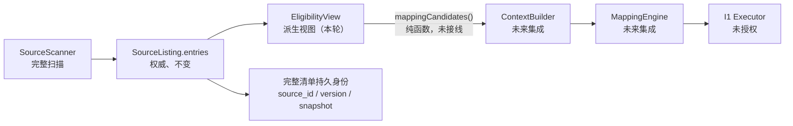

# Forma 导入资格策略（IMPORT-ELIGIBILITY-POLICY）

> 状态：P3-A 切片 2e + 2f，Issue #51 的**离线**部分。冻结 SPEC v0.1.1 未改；生产扫描、Context 与 Mapping 的默认输入行为未改；I1 写入未开发。
> 2e 交付纯规则引擎、资格视图、dry-run、统计与测试。2f 追加只读事实探测（§4.1）：文件元数据、`CACHEDIR.TAG` 与 Git 索引，全部只读。
> 仍然没有 Provider 调用、没有 DEVONthink 写入、没有 OneDrive hydration，也没有把任何路径写进导出。

## 1. Decision semantics

| 决策 | 含义 | 是否改变扫描 | 是否授予 Import |
| --- | --- | --- | --- |
| `INCLUDE` | 可以成为 **Mapping 候选** | 否 | **否** |
| `EXCLUDE` | 高置信技术噪声，默认不进入 Mapping | 否 | 否 |
| `REVIEW` | 业务价值或文件用途不确定，等人确认 | 否 | 否 |
| `DEFER` | 判定所需事实不可用、扫描不完整或权限不足 | 否 | 否 |

四个决策都不删除、不移动、不重命名、不改写任何源文件。`INCLUDE` 不是 Import 资格，也不授予 Provider 外发权限；这两件事分别属于 I1 与 `docs/PRIVACY-EGRESS-CONTRACT.md` 的授权范围。

## 2. Discovered / Mappable / ImportEligible 边界



- `SourceListing.entries` 是唯一权威。视图不改写它、不改写 `SourceStore`、不新造 Context revision、不写 Manifest。
- `Discovered` 是扫描事实；`Mappable` 是本策略的判定；`ImportEligible` 只可能由未来的 I1 Executor 在重新核验后给出。三者不得互相冒充。
- 扫描失败而没有产生 entry 的路径，单独计入 `summary.unaccounted` 与 `scanIssueCount`，既不会变成"已发现文件"，也不会从摘要里消失。

## 3. Rules and precedence

优先级从高到低：

1. 安全与可信业务证据
2. Owner 精确包含 / 排除
3. 高置信技术缓存证据
4. 项目上下文（嵌套仓库、Git tracked、源码/部署配置、可重建产物）
5. 弱名称 / 扩展名 / 目录启发式

规则按 `(priority 降序, rule_id 升序)` 排序后取第一条命中；JSON 文件里规则的排列顺序不影响结果。所有命中规则都保留在 `matchedRuleIDs` 中，`decidedByRuleID` 单独标出胜者，便于审阅"为什么是这条"。

三条结构性保护优先于任何规则排序：

| 保护 | 效果 |
| --- | --- |
| 已确认业务证据 | 任何 `EXCLUDE` 降级为 `REVIEW`（`business_evidence_overrides_exclusion`） |
| Git tracked / 嵌套仓库 / 源码或部署配置 | 强缓存排除也降级为 `REVIEW`（`git_tracked_protected` / `nested_repository_protected` / `source_code_protected`） |
| 弱证据排除 | 加载期拒绝（`EXCLUDE` 必须 `evidence_strength = strong`），运行期再降级一次 |

第四条结构性保护：**排除前必须已核验的事实**。每个 `EXCLUDE` 规则声明 `protection_facts`，分类器在发出 `EXCLUDE` 前逐项检查这些事实是否已被探测或人工确认；任何一项仍是 `unknown`，结果降级为 `REVIEW`（`protection_fact_unknown`，`follow_up = probe_facts`）。"没查过"不是"没有"：未运行、失败、超时或被取消的探测都不会被读成排除依据。

`build`、`dist`、`bin`、`target`、`vendor`、`.build`、`coverage` **只产生 `REVIEW`**，从不单独触发 `EXCLUDE`。正式技术资料、客户交付物、已提交发布包、业务附件与历史版本因此不会因为目录名被误排除。

高置信技术噪声（当前策略）：`.DS_Store`、AppleDouble `._*`、Office 锁文件 `~$*`、以及**签名已验证**的 `CACHEDIR.TAG` 所标识的缓存上下文。

## 4. Policy JSON contract

`Sources/FormaCore/Eligibility/Policies/forma-eligibility.v1.json`：

```json
{
  "schema_version": "1.0",
  "policy_id": "forma-import-eligibility",
  "policy_version": "eligibility.v2",
  "profiles": [],
  "rules": [
    {
      "rule_id": "technical-noise-ds-store",
      "priority": 85,
      "decision": "EXCLUDE",
      "evidence_strength": "strong",
      "explanation_code": "technical_noise_ds_store",
      "all": [{ "basenames": [".DS_Store"] }],
      "protection_facts": []
    },
    {
      "rule_id": "verified-cache-directory",
      "priority": 90,
      "decision": "EXCLUDE",
      "evidence_strength": "strong",
      "explanation_code": "verified_cache_marker",
      "all": [{ "facts": { "cacheMarker": "verified" } }],
      "protection_facts": ["gitTracked", "nestedRepository"]
    }
  ]
}
```

条件语言是**声明式比较**，不是表达式引擎：`extensions`、`basenames`、`basename_prefixes`、`path_components`、`entry_states`、`providers`、`hydration_pending`、`facts`、`scan_issue_reasons`、`minimum_size_bytes`、`maximum_size_bytes`。一个 predicate 内所有已填字段必须同时满足；`all` 是 AND，`any` 是 OR。规则不能执行命令、访问网络、读文件或调用模型。

`facts` 只接受已知事实名（`gitTracked`、`cacheMarker`、`nestedRepository`、`businessEvidence`、`sourceCodeOrDeployment`、`rebuildableArtifact`），测试会拒绝未知事实名。`protection_facts` 使用同一名字集合，未知名字同样在加载期拒绝。

`protection_facts` 省略时，`EXCLUDE` 规则默认取 `["gitTracked", "nestedRepository"]`（fail-safe：新增排除规则自动继承护栏）；只有显式写 `[]` 才声明"这条规则自证，无需探测事实"（例如按文件名识别的 `.DS_Store`）。`INCLUDE` / `REVIEW` / `DEFER` 规则默认 `[]`。

契约：

- **确定性解析**：`FormaJSON` + 显式 `CodingKeys`。
- **校验**：schema 版本、非空 policy id/version、规则 ID 唯一、至少一个条件、`EXCLUDE` 必须 `strong`、profile 列表去重。违反即 `FormaError.incompatible`。
- **canonical serialization**：规则按分类器顺序、profile 排序、key 排序后编码。
- **policy digest**：`SHA-256(canonical bytes)`；同内容不同文件顺序 → 同 digest。
- **同输入 + 同版本 = 同结果**：分类器是纯函数。
- **变更失效**：override 绑定 `policyVersion`，版本变化后旧覆写为 `stale_policy`。
- **版本 v2**：新增 `protection_facts`；同一个快照在 v1 下可能被排除，在 v2 下因事实未核验而变为 `REVIEW`。这是收紧，不是放宽。

## 4.1 Read-only fact probe

`EligibilityFactCollector`（`Sources/FormaCore/Eligibility/EligibilityFactProbe.swift`）只做三件事，全部只读：

| 事实 | 观测方式 | `confirmed` 条件 |
| --- | --- | --- |
| `cacheMarker` | 从文件的父目录逐级向上到授权根，`openat(..., O_NOFOLLOW)` 读取 `CACHEDIR.TAG` | 首个字节以 `Signature: 8a477f597d28d172789f06886806bc55` 开头 |
| `nestedRepository` | 从授权根向下到父目录，`fstatat(.git, AT_SYMLINK_NOFOLLOW)` | 找到 `.git` 目录，或 `.git` 文件的 `gitdir:` 解析后仍在授权根内 |
| `gitTracked` | 固定可执行文件、无 shell、清洗环境的 `git ls-files -z` | `rev-parse --show-toplevel` 的顶层**就是**授权根本身 |

拒绝与降级规则：

- **绝不读授权根之外**：所有路径经 `SourceRootAccess.openDirectory` 打开（逐段 `O_NOFOLLOW`、校验根身份、校验设备）。`GIT_CEILING_DIRECTORIES` 固定为授权根，Git 不会向上越过它查找仓库。
- **根不是仓库顶层 → `unknown`**（`repository_not_at_scope`）。子目录形式的仓库不会因为"父目录里可能有 `.git`"而被读；`gitTracked` 也不会被写成 `no`。
- **仓库顶层在授权根之外 → `unknown`**（`repository_outside_authorization`，`outside_authorization`）。
- **符号链接**：`.git`、`CACHEDIR.TAG`、entry 本身遇到 symlink 一律不跟随，报告 `symlink` / `git_symlink`。
- **超限**：`CACHEDIR.TAG` 超过 1 KiB、`.git` 文件超过 4 KiB、Git 输出超过 `gitOutputLimitBytes` 都报告 `oversized` / `git_output_limit`，不读入内存。
- **读取期间变化**：读前后 `fstat` 的对象键、大小、mtime 必须一致，否则 `changed_during_read`。
- **entry 与 listing 不一致**：大小或 mtime 不匹配 → `snapshotChanged = true`，分类器给出 `DEFER`。
- **有界**：`maxEntries`（默认 5000）、`deadline`（默认 10 s）、`gitTimeout`（默认 5 s）。超出上限的条目计入 `skipped`，超时与取消分别记为 `timedOut` / `cancelled`，都不静默丢弃。
- **只读**：不创建、不删除、不移动、不改写源文件；Git 只用只读子命令，`GIT_OPTIONAL_LOCKS=0`，`core.fsmonitor` 与 hooks 关闭。

`EligibilityProbeResult` 为每条记录保留逐事实 `provenance`（`status` + 稳定 `reason` 码 + 不含路径的短摘要/计数），并给出条目级聚合状态。导出的 `scopeID` 由根的文件身份派生，不含路径。

`businessEvidence`、`sourceCodeOrDeployment`、`rebuildableArtifact` **不由探测推断**：它们来自人工确认或未来授权的探测，调用方传入的值原样保留。

### 4.2 Known limits

- 不读取授权根之上的 Git 元数据，因此"授权根是某个更大仓库的子目录"时 `gitTracked` 保持 `unknown`，缓存排除需要人工确认。这是有意的：读它就等于越过授权范围。
- 探测不判断 `businessEvidence`，也不判断文件内容；`REVIEW` 仍然需要人。
- Linux 合成夹具只能证明规则与探测逻辑，不能替代 macOS 上的真实文件系统、APFS 与 OneDrive 行为。

## 5. Override semantics

`EligibilityOverride` 绑定 `sourceID` + `snapshotFingerprint` + `policyVersion` + `decision` + `authorCode` + `createdAt`。

| 状态 | 触发 | 行为 |
| --- | --- | --- |
| `applied` | 身份、快照、版本全部一致 | 按 §5.1 应用 |
| `stale_snapshot` | 快照已变 | 不应用，保留规则决策，`follow_up = reconcile_override` |
| `stale_policy` | 策略版本已变 | 同上 |
| `unknown_source` | 没有对应 entry | 不应用 |
| `conflicting` | 同一 source 有多个覆写 | 不应用，`follow_up = resolve_override_conflict` |

### 5.1 覆写的边界

- **手工 INCLUDE** 只把 `EXCLUDE`/`REVIEW` 变成 Mapping 候选；它**不能**把 `DEFER` 变成候选（`override_blocked_by_defer`），因为缺的是事实，不是判断。
- **手工 EXCLUDE** 在已确认业务证据前降级为 `REVIEW`（`override_blocked_by_business_evidence`）。
- 覆写只改变 Mapping 候选判断，不授予 Import 或外发权限。
- 不增加逐文件审批门禁：只有被显式标记的文件才需要人工决定。

## 6. Snapshot and invalidation

- 视图为每条记录同时保留 `originalState`、`decision`、`decidedByRuleID`、`matchedRuleIDs`、`policyVersion`、`explanationCode`、`followUp`、`overrideState` 与 `notes`。
- 快照指纹变化、路径冲突、entry 变为 `missing`、扫描不完整、权限失败都会产生 `DEFER` 并给出原因，不会退回旧的 `INCLUDE`。
- Policy 版本变化使该版本的 override 失效；重新评估会给出新决策与新 digest。
- 视图构建是纯函数：不写库、不递增 Context revision、不写 Manifest。

## 7. Dry-run statistics

`EligibilitySummary`（可导出，路径无关）：

- `discovered`、`include`、`exclude`、`review`、`defer`，满足 `discovered == include + exclude + review + defer`；
- `unaccounted`（没有 entry 的扫描问题）与 `scan_issue_count`；
- `mapping_candidates`、`estimated_excluded_logical_bytes`、`unknown_size_records`；
- `per_profile`、`per_rule`。

`EligibilityExport` 另含 `policy_id`/`policy_version`/`policy_digest`/`scan_state`/`metrics` 与逐记录摘要（source id、decision、rule、reason、override state、size）。**不含路径、文件名、客户名或证据正文。**

关于体积：`estimated_excluded_logical_bytes` 是**逻辑大小**之和，不是物理磁盘可节省量。硬链接、APFS clone、OneDrive 占位文件、压缩与稀疏文件都使物理节省未知；导出的 `assumption` 明确写出这一点。

关于 Token：没有真实 Provider usage 时 `token_reduction` 为 `unavailable`；只有调用方显式给出 `tokensPerExcludedFile` 才输出 `extrapolated`，并公开"每文件 token 恒定"的假设。它**不是**真实 Token 节省，也不是实付费用减少。

## 8. False-exclusion evaluation

| 指标 | 分子 | 分母 | 单位 | 来源 | kind | 不可用条件 |
| --- | --- | --- | --- | --- | --- | --- |
| `false_exclusion_rate` | 被标为应保护样本中判为 `EXCLUDE` 的数量 | 该 fixture 中应保护样本总数 | records | 独立标注的业务样本 | 请求声明的 kind（合成 fixture = `simulated`） | 无应保护样本 |
| `review_rate` | `REVIEW` 数 | `discovered` | records | 本次 listing | 同上 | `discovered == 0` |
| `mapping_candidates_reduction` | `discovered − include` | `discovered` | records | 本次 listing | 同上 | `discovered == 0` |
| `token_reduction` | `exclude × tokensPerFile` | `discovered × tokensPerFile` | tokens | 调用方假设 | `extrapolated` | 无 usage 且无假设 |
| `estimated_import_bytes_reduction` | 被排除记录的逻辑字节 | 全部已知逻辑字节 | logical_bytes | `size_bytes` | `extrapolated` | 无任何记录报告大小 |

分母**必须**是"已独立标注为应保留的业务样本"，不是"所有被排除记录"——后者会让漏排看起来更小。合成数据只能报告 synthetic fixture false exclusion，不能宣布真实业务误排除率达标；真实对照仍属 M10 / P3-B。

零分母统一输出 `N/A`（`value == nil` + `unavailable_reason`），不是 0%。

## 9. Mole design attribution and license review

设计参考：`tw93/Mole@64daaf86499c7`（GPL-3.0），具体为 `lib/clean/purge_shared.sh`（候选产物、`CACHEDIR.TAG` signature、Git tracked 检查）、`lib/clean/project.sh`（名称不代表可重建、嵌套仓库与活跃项目的保守处理）、`lib/core/base.sh`（白名单与不可覆盖的强制保护分层）、`SECURITY_AUDIT.md`（不确定即拒绝）。

本轮结论：

- **没有复制、翻译、改写或移植任何 Mole 源码、shell 函数、规则表文本或 fixture**。`EligibilityPolicy` 的 JSON 规则、`EligibilityClassifier` 的算法与全部测试夹具均为本仓库独立编写。
- 没有引入 GPL/AGPL 传递依赖，没有打包 Mole 代码或资源，`Package.swift` 未新增任何依赖。
- 只吸收了不受版权保护的设计思想与通用文件格式事实（如 `CACHEDIR.TAG` 标准签名、AppleDouble 命名约定、Office 锁文件命名约定）。
- Mole 的"最近 7 天默认不勾选"是删除风险控制，不是归档价值判据，**未迁移**。
- 署名不能代替许可证授权；若未来希望复用其代码，须先取得权利人另行商业许可。

## 10. Integration Contract Delta（**未实施，需 Owner 批准**）

未来正式接入点是 `SourceListing → EligibilityView → ContextBuilder → MappingEngine`。本轮**只**提供 `EligibilityView.mappingCandidates()` 这个纯函数，生产 `buildContext` / `MappingEngine.run` 的默认输入未变。接入前必须先回答：

1. **结果如何存储**：完整 `SourceListing` 保持不变的前提下，eligibility 结果按 `(source_id, snapshot_fingerprint, policy_version, policy_digest)` 存储为派生表，而不是覆盖 entry 字段；视图可随时由 listing + policy + facts 重算。
2. **Context revision 如何失效**：过滤输入会改变 `ContextBuilder.inputDigest`，因此必须在新 digest 中纳入 `policy_digest` 与参与判定的 fact 摘要；旧 revision 保留可查，新 revision 由新输入产生，不能原地改写。
3. **Manifest 未映射记录如何解释**：被 `EXCLUDE`/`REVIEW`/`DEFER` 的记录不会出现在 Manifest 中；报告必须单列"未进入 Mapping 的已发现记录数 + 原因分布"，否则读者会把它当成"目录里没有这个文件"。
4. **排除记录如何可追溯与可恢复**：保留 `source_id`、原始扫描状态、规则 ID、策略版本与 digest；改策略或覆写后重算即可恢复为候选，不需要重新扫描。
5. **Rule revision 与 snapshot 如何绑定**：override 已绑定二者；Manifest envelope 若记录 eligibility 结论，必须同时记录 `policy_digest` 与逐记录 `decided_by_rule_id`，否则无法判断一个旧 Manifest 是用哪套规则产生的。
6. **I1 Executor 如何独立重新核验**：Executor 不得信任 UI 过滤或缓存结论；它在写入前用固定 policy digest + 当前 snapshot 重新判定，`EXCLUDE`/`REVIEW`/`DEFER` 一律不自动写入，并把原因写入 Ledger。

以上任何一项都会改变正式契约（Context 输入、Manifest 解释或 I1 行为），因此**本轮不实施**；需要 Owner 明确批准后才能作为独立切片推进。

## 11. Known limitations

- 规则只消费调用方提供的事实；本切片不实现 Git 探测、`CACHEDIR.TAG` 读取或扩展名统计，合成 fixture 直接注入这些事实。真实探测属于后续切片。
- `SensitiveContentScanner`/脱敏属于外发契约，不是本策略的一部分；资格判定不读取正文。
- 目录名启发式（`vendor`/`build`/…）只产生 `REVIEW`；它们既不能证明是业务文件，也不能证明是噪声。
- 规则语言刻意狭窄：没有正则、没有脚本、没有跨记录条件。复杂判断应由人（`REVIEW`）或未来经批准的事实提供者完成。
- `estimated_excluded_logical_bytes` 不预测物理磁盘节省；`token_reduction` 在无假设时不可用。
- 视图在内存中构建；10k 规模的合成分支已测试确定性，但没有数据库索引或缓存层（尚无可证明的需要）。

## 12. I1 deferred items

- Import Executor、写入仲裁、Ledger 与 DEVONthink 写入（未授权）。
- 真实 Git tracked / 嵌套仓库 / `CACHEDIR.TAG` 探测。
- 真实 OneDrive dataless 与权限失败现场验证（M4 / M10）。
- 真实业务样本的误排除率对照（P3-B 外部前置条件）。
- 生产 `buildContext`/`MappingEngine` 过滤接线（见 §10 Contract Delta）。
- macOS 现场：真实目录上的策略统计与人工复核工作流（M11）。
