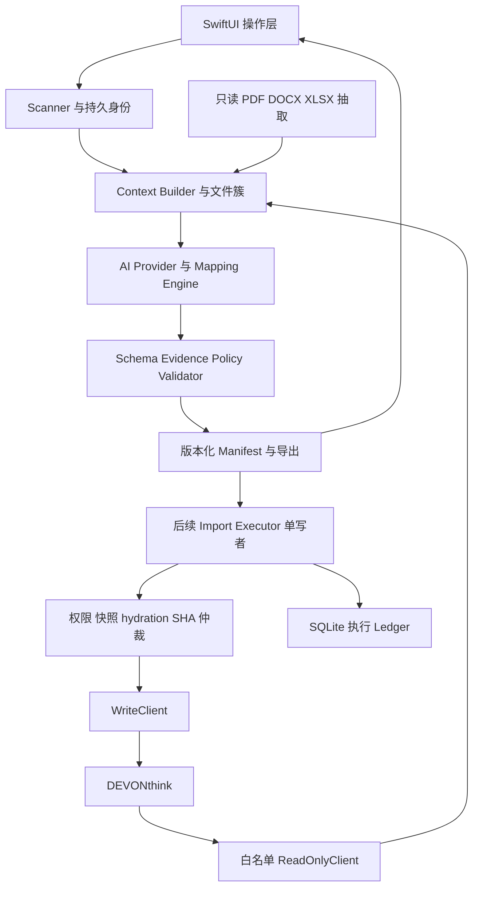

# Forma 技术实施计划（候选）

版本：PLAN v0.1；基线：[SPEC v0.1.1 FROZEN](SPEC.md)；日期：2026-11-10。状态：提交 Owner 集中架构复核，**不代表开发、建 Project 或写入 DEVONthink 已获授权**。

本轮只交付本文件。冻结 SPEC、应用代码、工程、CI、GitHub Issues/Project/Milestones 和生产档案均不改动。PLAN 通过复核后，仍须 Owner 另行明确授权才能建立 Roadmap、进入实施。下文所有运行指标均为待实施的验收要求，不能解读为已取得实测结果。

## 1. 实施结论与范围

以 Swift 6、SwiftUI、Swift Concurrency 构建单个 macOS 应用；必要时使用 AppKit、PDFKit、Quick Look。业务核心与界面分离，但不提前拆成服务、插件平台或通用工作流框架。SQLite/GRDB 管理持久状态，CryptoKit 增量 SHA-256 管理内容身份，Keychain 管理密钥。开发基线建议 macOS 14+、支持 Swift 6 严格并发的稳定 Xcode；具体部署版本在 P0 根据 DEVONthink、文件提供器和依赖兼容性确认，尚非实测结论。

优先完成真实目录 → 项目级上下文 → 双 Profile AI Mapping → 可验证 Manifest → 界面预览/导出及独立评测。Prototype 仅允许隔离数据库的只读 MCP；即使测试数据库可丢弃，也禁止写入。Import 在后续独立阶段实现，所有生产数据保持不动。

不采用 Rust/Tauri、Embedding、Vector DB、传统 RAG、模型训练或全量历史档案搬运。20–30 条精选案例用于 Few-shot。历史正文只按需、经权限过滤读取；SQLite 不成为 DEVONthink 正文或实际记录的替代权威。

## 2. 基线、历史证据与适用边界

输入优先级为 SPEC → PLAN_REQUEST/AGENTS → 固定历史提交。SPEC 与实现建议冲突时保持 SPEC，在 §13 记录待决项；不在实现中悄悄改变政策。

### 2.1 历史材料的使用方式

固定来源为 [`Skyline-Gazer/tmp@cba4bc3`](https://github.com/Skyline-Gazer/tmp/commit/cba4bc35831b67ebb3a41bfbc70a9fe89c7b428b)，不是滚动分支最新内容。本轮通过认证只读 GitHub GET 核实分支及固定提交并阅读下列材料；参考库可访问，没有以猜测补足访问缺口。以下“历史验证”仅指该提交内报告或账本，**不是本轮对当前 DEVONthink/MCP 的实测**；未实测能力仍列入 §12。

不重新审计 991 条文件。仅核验规则、质量报告、71 条纠正的语义总结和案例库格式；不把业务文件名、客户/人员、报价、UUID 账本、内部路径或正文复制进公开仓库。公开案例全部匿名或合成，受限真实样本留在用户本地。

| 固定提交内材料 | 本轮核验范围及对 PLAN 的影响 |
|---|---|
| [新增文件分类规则](https://github.com/Skyline-Gazer/tmp/blob/cba4bc35831b67ebb3a41bfbc70a9fe89c7b428b/reports/Project_Archive-新增文件分类规则.md)、[分类质量报告](https://github.com/Skyline-Gazer/tmp/blob/cba4bc35831b67ebb3a41bfbc70a9fe89c7b428b/reports/Project_Archive-分类质量报告.md) | 规则、71条纠正与回读验收；提炼用途/填写状态/主体角色等语义，不搬运逐条业务记录 |
| [分类样本库](https://github.com/Skyline-Gazer/tmp/blob/cba4bc35831b67ebb3a41bfbc70a9fe89c7b428b/reports/Project_Archive-分类样本库.json)、样本治理修正及分类执行账本 | 一次性核验JSON结构/统计及纠正链；schema 1.0、991条、10条有序规则，33条规则正例/23条反例不等于已审核Few-shot；全量 human_confirmed=false |
| [MCP能力审计](https://github.com/Skyline-Gazer/tmp/blob/cba4bc35831b67ebb3a41bfbc70a9fe89c7b428b/20261109T110500/reports/DEVONthink-MCP-Capability-Audit.md)及metadata写入证据 | 当时62工具中16项VERIFIED、46项SUPPORTED_UNTESTED；能力矩阵是时间点快照，必须结合后续回读账本，不能套用到当前版本 |
| [导入E2E报告](https://github.com/Skyline-Gazer/tmp/blob/cba4bc35831b67ebb3a41bfbc70a9fe89c7b428b/reports/DEVONthink-Project-Archive-E2E.md)、[Patcher验收](https://github.com/Skyline-Gazer/tmp/blob/cba4bc35831b67ebb3a41bfbc70a9fe89c7b428b/20261109T120528/reports/PATCHER_ACCEPTANCE.md)及v4/v6映射规范 | OneDrive占位超时、源目标SHA、dry-run/Preflight、写前快照、逐字段回读与resume-verify；只吸收经验，不迁移历史Python实现 |

历史报告显示71/71纠正回读通过、其他业务元数据意外变化为0、991条Group与类别一致，但仍有50条未解决（41待分类、9留在既有类别）；所以“位置与类别一致”不等于“全部语义正确”。证据等级为78条有限正文抽检、664条文件名/路径高置信弱样本、143条中置信、56条仅历史标签、50条未解决；全量均非human-confirmed金标准，不能自动填满评测集。

MCP关键历史边界：`set_record_custom_metadata`只在一次性记录验证，`merge`保留未指定字段，`replace`删除未提供字段，因此后续仅采用经现场验证的merge/精确字段更新；批量调用存在部分成功，不是原子事务。能力审计当时未执行`move_record`/`import_file`/`replicate_record`，后续分类账本才有move及回读，不能把审计的未测或后续成功泛化。Replicant仍无创建/回读证据。`extract_record_content`的限制参数为`max_token_count`，不支持`max_chars`；项目元数据查询曾出现完整字符串无命中而`==`谓词命中的差异，搜索无结果不能证明不存在。历史材料无MCP标准SHA工具，SHA由宿主侧计算；中文字段Label不能靠MCP改名。

OneDrive历史存在全读预热后仍dataless并报POSIX ETIMEDOUT的文件，下载吞吐远慢于本地hash；不把路径存在、尝试预热或等待固定时长当作就绪。导入验收依赖源目标SHA、UUID、位置与字段一起核对；治理轮未重算全量SHA。恢复经验为写前落快照、写后逐字段回读，超时进入UNCERTAIN/RECOVERY_REQUIRED并先对账，禁止盲重试。历史批次清单存在3504/3511两种规模口径、计划与move账本计数也有未解释差异；不将其作为Forma性能或执行完整性基线，不扩大本轮为旧数据重审。历史Preflight的小批次、dry-run经验只用于降低测试风险，不迁移成对正常批次的额外审批门禁。

### 2.2 必须吸收的领域约束

- 分类由文件用途、填写状态、角色和项目关系决定。路径、前缀、扩展名只提供可推翻线索。
- 空白采购报价模板属于采购附件；独立实际报价属于 `05`；投标商务/价格分册属于 `02`。
- 填有品牌型号、实际响应和偏差的技术表属于 `02`；通用技术表和编制素材可属于 `04`。
- 项目授权、原厂项目承诺属于 `03`；操作性的激活/授权指南可属于 `04`。
- 通用 Datasheet 与客户专用投标方案区分用途；项目名含“采购”不推翻正文为投标稿的证据。
- 归档完成年、投标期限、产品版本年互不替代。客户、投标主体、出具方与品牌是不同角色。
- 相同字节不等于同一档案记录；移动、改分类和 Replicant 创建是不同能力。

## 3. 架构、职责与代码组织建议

### 3.1 数据流与权限边界



| 模块 | 输入 → 输出 | 职责与约束 |
|---|---|---|
| SourceAccess / Scanner | 授权目录 → 注册来源、完整扫描清单、快照 | 原生枚举及资源属性；不强制 hydration/全文/SHA；仅程序分配身份 |
| EvidenceExtractor | 按需请求 → 定位到页/字符/单元格的证据片段 | 限页数、单元格数、解压大小和并发；明确未读、加密、损坏、占位未就绪 |
| ContextBuilder | 全清单、目录邻近、文件簇 → 项目候选上下文 | 先发现来源项目再对齐只读历史；不假定固定层级，不把历史名称列表当真值 |
| AIProvider | 受控消息、Schema → 原始结构化响应、usage | 不持有文件写权限和 MCP 工具；实现差异在边界消化 |
| MappingEngine | Profile、案例、上下文、证据 → MappingProposal | 项目级映射、冲突、未知、一次有界复判；不产生系统身份或执行许可 |
| ManifestValidator | Proposal + 程序事实 → ManifestRevision | 语法、字段、证据、Profile、权限、快照、自动执行资格分层验证 |
| Profile / CasePack | 版本化 JSON → 可复现政策与案例 | 两 Profile 分别演进；修改版本使相关验证过期 |
| TaskStore | 领域状态 → SQLite 事务/查询 | 持久化重扫、取消、崩溃恢复、修正记录；不缓存全库正文 |
| DEVONthinkAdapter | 类型化请求 → 规范化事实与错误 | 同一 transport、不同权限入口；只读白名单；回读独立于写响应 |
| ImportExecutor（后续） | 固定 Manifest → 操作结果与 Ledger | 唯一写入者，不重新分类；未知结果先核查；不修改源文件 |
| SwiftUI 操作层 | 上述状态 → Workspace / Mapping / Exceptions / Settings | 可取消长任务，显示字段证据和失效原因；不在 View 内写业务逻辑 |

ReadOnlyClient 不能接收任意工具名透传，模型只获得结构化查询结果。WriteClient 的构造与持有只允许 ImportExecutor 所在执行模块；Prototype 组合根不创建写客户端。权限隔离覆盖类型接口和运行时工具分派，不能只在 Prompt 里说“禁止写入”。不增加独立常驻服务：应用内 actor 协调即可。

### 3.2 建议目录（未来实现，不在本轮创建）

```text
FormaApp/                    SwiftUI App、组合根、四个主界面
FormaCore/
  Sources/                   SourceAccess、Scanner、Identity、Snapshot
  Mapping/                   ContextBuilder、Provider、Mapper、Validator
  Evidence/                  PDF、DOCX、XLSX 最小抽取
  Domain/                    Manifest、Profile、Evidence、Correction
  Persistence/               GRDB migrations、repositories、ledger
  DEVONthink/                MCPTransport、ReadOnlyClient、WriteClient
  Import/                    Preflight、Executor、Reconciliation
Resources/
  Schemas/                   Manifest / Proposal / Profile / CasePack
  Profiles/                  project-archive.v1、vendor-library.v1
  CasePacks/                 仅审核脱敏/合成精选案例
Tests/                       仅关键身份、证据、仲裁、恢复的行为测试
Evaluation/                  脱敏评测定义、指标与报告模板
```

建议一个 Xcode 应用目标配一个本地 Swift package 管理核心模块及测试；先按目录和访问控制隔离，不把每个目录拆成 package。应用层 `@MainActor`；扫描、存储、Provider、MCP 连接各自 actor 或明确 Sendable 值；文件抽取在有界后台任务运行，不占用主线程。

依赖只建议 GRDB 与 ZIPFoundation；PDFKit、XMLParser、URLSession、CryptoKit 使用系统框架。ZIPFoundation 用于 DOCX/XLSX ZIP 容器，XMLParser 读取 OpenXML；在 P0/P1 验证 Swift 6、许可证、体积及兼容性后锁定版本。不提前支持公式计算、宏执行、Office 渲染或后台 Python。JSON Schema 选支持所用 Draft 2020-12 子集的成熟 Swift 校验实现；P0 做最小兼容探针并锁版本，不能以 Codable 解码代替 Schema 验证。字段证据与业务规则由显式 Swift Validator 完成，不造通用规则语言。

## 4. 来源身份、快照和持久状态契约

### 4.1 注册来源与稳定身份

1. 用户注册根目录时分配并持久化 `source_root_id`（UUID），保存 security-scoped bookmark、根目录资源标识及卷大小写语义。移动卷名不改变注册 ID；失效 bookmark 需重新授权，不能另建任务悄悄绕过。
2. 保存原始相对路径和用于匹配的规范路径。分隔符统一 `/`，消去 `.`，拒绝绝对路径、`..` 越根和 NUL。按卷实际大小写/Unicode 等价语义匹配，建议 NFC；保留原始拼写用于定位。不盲目全局 lowercased；比较冲突或卷语义无法确定时 hold，不把两个文件折叠。
3. SQLite 唯一约束为 `(source_root_id, normalized_relative_path)`。首次发现分配 UUID（采用成熟 UUIDv4 即满足逻辑身份要求，不为 UUIDv7 引入额外依赖），重复扫描复用 `source_id`。扫描事务提交后才发布结果。
4. 同路径内容替换仍保留 `source_id`，增加 `source_version` 和快照修订；`source_id` 不能用于证明内容相同。同名不同路径默认不同条目。
5. 重命名/移动仅在同注册来源内有可靠稳定资源标识、唯一一对一候选且无旧路径竞争时续用 ID，并写 path_history。File Provider 标识不可公开获取/不稳定时按能力缺失处理。只有 inode 相同或 SHA 相同均不足以自动续接身份；跨卷/云端重建无可靠关联时新 ID，旧项为 missing/moved_candidate，后续只建立可审计候选关系。
6. 缺失只在该根完整扫描成功后标记；权限失败、取消或局部不可读不得批量标 missing。符号链接默认记录但不递归、不越权追踪，避免循环及授权根之外读取。

**父子根重叠：** 注册时通过已解析目录与可信资源标识检测祖先关系。同卷同目录已有注册则复用；父子重叠默认归属最先注册的规范根，子目录作为扫描范围而非第二来源身份。若已有两个来源注册，暂停重叠部分并显式选择规范根，在单事务中迁移路径映射、保留 source_id/别名和历史 Ledger，解决冲突后再扫描；不因扩大扫描范围自动重新导入。无法可靠证明同一根时提示重叠候选并 hold 涉及部分。不同 Profile 使用同来源扫描事实、各有 Manifest/association，不生成第二套来源身份。

### 4.2 确定性 snapshot_fingerprint

按版本 `snapshot.v1` 生成固定字段顺序、UTF-8、整数单位明确的规范 JSON，字段为 `source_id, source_version, size_bytes, mtime_ns, resource_identity_kind, resource_identity_value, provider_version, sha256`；不可用值显式 null。以 CryptoKit SHA-256 对规范字节摘要作为 fingerprint。资源标识是本地受限数据，不导出内部原值；inode 仅作诊断，不冒充稳定资源标识。hydration 状态单独保存，不把占位标志变化当作内容必然改变。

`source_version` 是 SQLite 单调版本：任一可信内容变更信号、同路径替换、身份异常或读前后属性不一致均增加。初次扫描可没有 SHA；抽取或 Preflight 取得 SHA 后生成更强的新快照修订，旧 Manifest 必须重新绑定并验证，禁止静默替换指纹。若只有证据强度升级且上下文未变，可由程序重新验证、继承语义形成新 Manifest，不重复调用 AI；实际字节/上下文变化必须重新抽取，受影响字段重新映射。

mtime、大小和资源版本都不是不可篡改证明。文件内容改变且所有可见属性被恢复时，纯元数据扫描无法保证检测；PLAN 不承诺这一点。凡读取正文以形成证据，记录抽取输入 SHA；按同一协调读取、前后 stat/版本检查确认。Import 前必须 hydration 并重算或在可证明未变的同一读取会话取得源 SHA，对照证据版本；无法证明原映射字节一致则 hold/重提取，不能拿缓存 mtime 单独放行。hash 缓存键含来源、版本、资源身份、大小、mtime，身份异常即失效，关键执行读不可仅依赖弱缓存。

### 4.3 SQLite 的最小数据模型

| 表/集合 | 关键键与内容 | 持久性约束 |
|---|---|---|
| source_roots / source_entries / path_history | 根 bookmark、规范路径、source_id、状态、历史路径 | 路径唯一、别名可追踪；不以绝对卷路径作为唯一身份 |
| scans / source_snapshots | scan_id、扫描完整性、source_version、fingerprint、hash_strength | 快照不可原位改写；失败扫描不发布完整清单 |
| context_revisions / evidence_items | 文件簇、候选项目、提取器/策略版本、locator、片段摘要 | 上下文有输入依赖；正文最小片段本地保存、按任务清理 |
| manifests / manifest_entries | revision、输入摘要、Profile/案例/模型版本、来源快照、状态 | 旧修订保留，只有当前有效 validated 修订可执行 |
| associations | 来源、用途、Profile、目标数据库/Group、实际 UUID 关系 | 可导出；DT 实际位置/字段为最终真相 |
| tasks / provider_runs | 进度、取消、响应摘要、token、耗时、错误 | 不持久化密钥/默认完整 Prompt 或原文 |
| execution_operations / execution_events | operation_id、幂等键、阶段、意图、实际 UUID、回读 | 导入阶段启用；外部调用前先持久化意图 |
| corrections / case_candidates | 原/新判断、证据、审核、脱敏与入包历史 | append-only 修订，不覆盖原决定 |

GRDB migrations 管理版本，启用外键、事务和单写连接/队列。Manifest、Profile 和 CasePack 的正式 JSON 为可导出工件，SQLite 保存其不可变修订及索引；不再维护另一套权威值。任务重启从最后已提交阶段恢复，取消不删除 Ledger；清理缓存不删除执行关联。备份/恢复需包含 SQLite 与必要工件版本，bookmark/Keychain 另行重新授权。SQLite 遗失时进入 reconciliation_only：禁止直接导入，读取真实 DT 和可用导出账本，不能唯一确认的记录 hold。

## 5. Profile、Metadata 与目标布局

Profile JSON 至少包含 id/version、目标库绑定、Group 模板、类别/类型枚举、12 字段约束、unknown/hold 政策、字段继承规则、自动资格政策和 CasePack 引用。Profile 名称不是实际数据库 UUID，绑定由用户明确选择、只读回查，AI 无权新建或改目标库。

### 5.1 Project Archive v1

以现场既有布局为准，建议逻辑模板为 `/<归档完成年>/<已确认项目>/<六分类>`，六分类严格沿用 SPEC §5.1 的 `01_招标文件`、`02_投标文件`、`03_厂商支持文件`、`04_技术资料与编制素材`、`05_报价与商务`、`99_待分类`。不能推定实际生产树已符合建议模板；P0 只读核对后以 Profile 配置映射已有 Group，禁止擅自重组。

项目候选未确认或 completionyear 未知时允许导出 Manifest，但该文件 `hold` 且无执行资格。已有项目同名异义时使用库/Group 身份与证据区分，不能只按名字合并。`99` 是已确认项目下的实际待分类类别；进入 `99` 不等于获得自动执行许可，首版仍将缺乏关键用途证据的项 hold，避免借待分类绕过规则。

### 5.2 Vendor Library v1

建议选择独立的用户指定目标数据库，逻辑布局为 `/<已确认品牌或未确认品牌>/<文档类型或待分类>`；品牌是 Manifest 的语义属性，不新增 DT Custom Metadata 字段。类型覆盖 Datasheet、Spec Sheet、Whitepaper、Solution、Brochure、Manual、Guide。目标尚未存在时只生成符号目标用于 Prototype，不创建数据库/Group。最终库与目录由 V6 确认后绑定，Vendor 映射质量验证不依赖建库。

`projectname` 与 `completionyear` 可 null，不继承项目负责人或投标主体。出具方证据不足时 `issuer=null`，可以有品牌线索但不将品牌强填为法律主体。Vendor `documentcategory` 按其 Profile 的目标类型 Group 定义；不强制填 Project Archive 的 `04`。跨 Profile 仅保存用途关联候选，不假定跨库 Replicant。

### 5.3 12 字段契约

所有 Identifier 原样保留；现场 Label、原生类型、空值写法和读写方式由 V3 核实。以下是映射层约束，不授权创建、重命名或类型迁移。

| Identifier | 层级与约束 | 证据与 null 政策 |
|---|---|---|
| projectname | 项目字段；Project 必须已确认；Vendor 可空 | 目录与项目文档交叉证实或已核实项目上下文；冲突 hold |
| completionyear | 项目字段；Project 归档资格必需，四位年 | 用户确认的归档完成事实；不能由投标/产品年份代替；未知阻断 Project 归档 |
| bidderentity | 项目字段，可空 | 明确投标主体或经核实项目继承；不把客户当投标人 |
| department | 项目字段，可空 | 已核实组织上下文；未知 null |
| salesowner | 项目字段，可空 | 已核实组织上下文；未知 null |
| endcustomer | 项目字段，可空 | 最终客户证据；不混同采购代理、厂商或投标人 |
| biddeadline | 项目字段，可空，文本 YYYY-MM-DD | 截止日期语义及有效日历日期；不迁移 Date 类型 |
| tenderreference | 项目字段，可空 | 明确采购/招标编号，不继承相似档案编号 |
| bsdcode | 项目字段，可空 | 已确认内部编号/指定规则，不从日期拼造 |
| documentcategory | 文档字段；validated 归档必有 | 与目标实际 Group/Profile 枚举一致 |
| documenttype | 文档字段，可空 | 标题/内容支持的细分类型；与用途分别保存 |
| issuer | 文档字段，可空，高影响 | 当前文件署名/签章等明确主体证据；历史相似文档/品牌不足 |

项目字段只在“来源成员关系已确认 + 字段已有核实证据”时继承，继承引用 context_revision 和原始证据，不从邻近文件无条件广播。文档证据与项目证据冲突时保留两者并 hold 相关字段/条目；不按置信度选赢家。

## 6. AI Provider 与 Mapping Engine

### 6.1 项目级上下文与调用次序

1. 离线扫描完整清单，保留全部条目；按目录邻近性、命名实体、时间和文件簇构建候选。无法确定边界可存在多个候选；不以固定第 N 层作为项目。
2. 先进行批次/项目识别，输出候选成员关系和理由；可查询隔离 DT 的项目、Group、相关记录作为对照，历史匹配结果标明来源和匹配强度。
3. 向模型发送 Profile 字段规则、20–30 条精选 Few-shot、项目上下文及该批文件清单。大型目录按候选项目切分；超出 token 上限时只分文件子批，共享同一已版本化项目上下文，并合并后检测成员冲突，不截断遗漏文件。
4. 第一轮只提出 MappingProposal。Validator 标出缺证字段，程序按明确预算读取 PDF/DOCX/XLSX 证据；需要时只读查询相关历史。进行一次针对性复判，仍不足则 null/hold。不得无限循环调用模型。
5. 程序将 Proposal 与原始事实合并、验证为 Manifest。模型只能引用本批分配的临时 `entry_ref` 和 evidence_ref；任意返回的 source_id、hash、DT UUID、绝对路径、权限或执行指令均拒绝。

初始建议每批最多 100 条清单、单文档 PDF 前 3 页、DOCX 前 12,000 字符、XLSX 每表限定表头和最多 200 个选定单元格；均可调并计入输入版本。预算不足时显式 `truncated`，按需选择关键页/表，而不是声称读过全文。数字是待测起点，不是产品质量结论。

### 6.2 Provider 契约与结构化输出

先实现两个具体 Provider：OpenAI API 与 Anthropic API，使用真实可配置模型与 URLSession。通过单一薄协议统一 `request(schema, messages, limits) -> response(raw, usage, model_id, latency)`；各自保留原生端点和响应适配，不假设二者完全兼容同一 OpenAI 协议。本地兼容服务可配置 base URL 与能力声明，不引入第三套编排平台。

优先使用 Provider 原生受约束 JSON 能力，实际可用模型、Schema 子集和拒答格式由 V4 验证。远端声称 JSON 合法仍须本地验证。没有原生 schema 模式时使用 JSON 输出约束 + 本地校验；仅容许一次附校验错误的结构修复调用，不掩盖缺字段、捏造证据或将字符串 null 自动变值。未知枚举、重复 entry_ref、遗漏条目、额外身份字段、截断、拒答均进入明确错误/hold。429/网络失败的有界重试遵守 Retry-After 并记录尝试；取消立即停止后续批次。

模型、温度、Prompt/Schema/Profile/CasePack、上下文和脱敏版本写入 run revision。保存规范化输入摘要与最小必要可重放工件到本地受限目录；默认日志不写完整 Prompt/响应正文。每次统计实际输入/输出 token、缓存 token（若提供）、请求数、拒答/解析失败和实付口径。

### 6.3 最小抽取与不可信内容

| 格式 | 实现与定位 | 明确边界/回退 |
|---|---|---|
| PDF | PDFKit 只读提取文本；页码 + 字符区间 | 扫描件/受保护/无文本报告 unavailable；OCR 延后，不能称已读正文 |
| DOCX | ZIPFoundation + XMLParser；document.xml 的段落/表格文字 | 记录部件与段落/字符区间；不执行宏，不承诺修订/文本框全覆盖；解析失败 hold |
| XLSX | workbook relationships、sharedStrings、worksheet cells；表名+单元格 | 保留单元格类型/公式及已有缓存值并标注；不计算公式、不把空缓存当空白报价证据；隐藏页状态保留 |

提取器输出状态 `ok | truncated | unavailable | encrypted | corrupt | hydration_pending | changed_during_read` 和版本；非 ok 不可伪造已读取证据。XML 禁外部实体与网络访问；ZIP 限展开大小/条目数、拒绝路径穿越。文件内“改系统指令/调用写工具/跳过校验”等内容始终为数据，不能改变权限或自动执行政策。

## 7. Manifest、Schema、Evidence 与资格

### 7.1 三类工件

- MappingProposal：模型可写语义字段、entry_ref、证据引用、unknown/conflicts/confidence；不含可更改的程序身份和执行许可。
- ManifestEnvelope：程序填入 schema_version、manifest_id/revision、task_id、source_root_id、各 source_id/snapshot_fingerprint、profile_id/version、case_pack_version、provider/model_id、Prompt/提取器/脱敏版本、输入清单/上下文摘要、decision_version 和创建时间。
- ManifestEntry：程序绑定 source_relative_path、目标数据库/Group 的符号意图与已核实绑定、12 metadata、用途/文档类型、associations、字段 evidence/conflicts、state、invalidated_reason、eligible_for_auto_execution 和验证报告。SHA/DT UUID 如存在仅来自系统事实。

正式工件用版本化 JSON Schema，关闭非预期字段；明确 null/缺省/空字符串差异，枚举与字符串格式，source_id 引用唯一性和全清单覆盖由业务 Validator 补充。首版 `schema_version=1.0`；兼容迁移需新修订并再验证，不能将旧版本直接交 Executor。公开文档不放真实 Manifest。

### 7.2 Evidence 契约

每项包含 `evidence_id, field, source, locator, quote_or_value, extraction_status`；source 固定为 `filename | path | content | sibling | fs_metadata | mcp`。内容证据 locator 需有相对路径、快照、PDF 页/字符区间、DOCX 部件/段落或 XLSX 工作表/单元格；MCP locator 需目标数据库/记录 UUID、查询时间、工具和返回属性；本地保存，公开导出使用脱敏引用。sibling 必须连回具体来源及上下文成员关系，不允许循环互证。

程序先创建 evidence registry，模型引用 evidence_id 并提出字段解释；Validator 检查引用存在、属于授权输入/同一有效快照、定位范围有效、quote 与实际提取值一致、证据类型满足该字段规则。语义上是否支持结论仍由独立评测/纠正审核衡量，Schema 或精确 quote 匹配不能保证 AI 业务判断正确。Issuer 等高影响字段要求当前文档明确主体线索，不以相似档案检索结果代证。

### 7.3 决策状态与失效

| 状态 | 进入条件 | 可离开方式 |
|---|---|---|
| unknown | 尚未形成可靠用途/归属判断 | 补证后 mapped 或明确冲突 hold |
| hold | 关键证据缺失、冲突、格式/权限/上下文不满足 | 只重处理受影响项；人工纠正也须证据验证 |
| mapped | 语义候选存在，尚未完成程序验证 | validated 或 hold |
| validated | Schema/证据/政策/权限/当前快照检查通过 | 输入变更立即 invalidated；保留原修订 |

invalidated 是修订有效性标志，保留原 decision state 供审计；不得以旧 validated 状态继续执行。项目上下文变化会失效所有实际依赖该上下文的条目；CasePack/Profile/策略版本变更按依赖重新验证，不无条件复用结果。

`eligible_for_auto_execution` 仅由程序计算：当前有效 validated、目标与项目关键关系已确认、必需字段有符合政策的证据、无阻断冲突、Profile/Schema/授权匹配；进入 Import 时还需 Preflight、实际记录仲裁和执行阶段授权。非空可选高影响字段若缺证须清空为 null 或 hold，不因为填写率高而放行。Prototype 中该字段仅代表模拟资格，实际执行能力恒为关闭。模型自报 confidence 只作展示与评测，不授予写权限。Exceptions 按文件/任务处理，不强迫正常批次逐条批准或引入额外审批门禁。

导出包含 JSON Manifest、验证报告、缺失/冲突及版本摘要；用户可另选脱敏可分享版。离线查看和校验已保存工件不需要云端 Provider。

## 8. 样本、评测、隐私与 Correction Capture

### 8.1 样本获取与独立性

使用获准的真实目录清单和真实模型调用。真实文件与 gold 保留受限本地目录；公开仓库仅放脱敏/合成案例与汇总指标。先一次性核对历史案例 JSON 的结构、数量和质量字段，再抽选有代表性的材料，不重复审计全量。SPEC 引用的 78/664/143/56/50 是来源证据等级分布，均不能直接视为完整人工金标准。

精选 20–30 条训练提示案例，建议 24 条：12 条正例（含双 Profile）、8 条关键反例、4 条冲突/拒绝猜测。每项保存场景、匿名输入上下文、可追溯证据、期望值、为什么不选另一类、审核者/状态、证据等级及来源版本。案例包总量受控，新增采用替换/精简而不是无限追加。

独立评测目标 ≥150 条，六类及主要反例场景各争取 ≥10 条（场景可交叉计数，不能将同一文件重复计入总量）；两个 Profile 分别报告数量，Vendor 不能拿项目六分类的准确率替代。人工或独立审核者依据可核验正文/业务事实建立 gold；争议条目标记 adjudication_pending，不参与准确率分母但必须报告排除量。

分割优先按项目/来源簇；来源 UUID、source_id、SHA-256（可得时）和文件来源家族排除交集；无 SHA 时先隔离保守来源簇，补齐后再确认。模板近重复用规范化标题/文本片段比对及人工复核，不引入向量库。禁止同一文件不同版本或改名副本分落提示/评测；无法排除时移出评测。固定 split manifest 与 gold revision，评测后不向 Prompt 泄漏具体答案。若合格样本不足，报告数量与场景缺口，仍可展示功能，但**不得宣称类别准确率验收通过**。

### 8.2 指标、阈值建议与性能费用

评测单位为有效金标准文件；`auto_mapped` 指程序政策判定具自动资格的映射，不能用模型自报 high 替代。单文件仅一条主决策；提取/请求失败保留在 total 并计 hold，未审核 gold 单独报告。

| 指标 | 定义/报告 |
|---|---|
| coverage | auto_mapped / total |
| precision_auto | correct_auto_mapped / auto_mapped；正确至少同时满足 Profile、项目归属、目标类别 |
| high_confidence_error_rate | incorrect_high_confidence / high_confidence_predictions；high 是模型声明，单独统计 |
| field_precision | correct_nonnull_field_predictions / evaluated_nonnull_field_predictions；12 字段分别报告 |
| 漏填 | gold 有值而预测 null 的数量/对应 gold 非空数量；区分允许未知与错漏 |
| hold_rate | held / total；另列 unknown、失效、请求/解析失败数量 |
| 分层 | 每 Profile/类别/关键反例数量、混淆矩阵、拒判原因、95% Wilson 比例区间 |

所有零分母标 N/A；项目内相关样本另以项目簇 bootstrap 给不确定性或明确小样本局限，不能将文件独立性假设隐去。主 Provider 与第二 Provider 使用同一固定测试输入/Schema，分别测量，不要求判断完全一致。

建议提交 Owner 集中复核的业务目标：precision_auto ≥95%、coverage ≥70%、field_precision ≥98%；关键反例不能出现系统性混淆；独立 Vendor 的虚构项目、无证据法律主体填入均要求观察错误数为 0，同时公布样本数与区间。high_confidence_error_rate 建议 ≤2%，hold_rate 建议 ≤30%；样本不足不追求通过。阈值是建议、不是已批准政策；必须展示实际值与差距，Owner 未批准前不能声称最终质量 Gate 已通过，不为每批另设审批。

性能采集：真实本地 10,000 文件纯元数据扫描墙钟、文件数、硬件/系统/磁盘条件、峰值内存；不足 10,000 时报告实际规模，合成压力数据单列，不冒充真实实测。OneDrive 分列元数据扫描、首次 hydration、缓存命中后读取、SHA/抽取耗时。模型报告每批/每文件 token、请求次数、平均/P95 延迟、错误率、并发。费用写明 Provider、完整 model_id、计价日期/币种、输入/输出/缓存单价来源；按实际 usage 计算实测成本，另列 `1000/N × 实测费用` 外推及规模/重试假设，不把外推称实测。P0 无跑分，本轮不捏造数据。

> 实现状态（2026-11-12，P3-A 切片 2c，**不改变本节需求**）：合成压力数据单列与「每批/每文件 token、请求次数、平均/P95 延迟、错误率、并发」的采集由 `EvaluationRunner` / `EvaluationTelemetry`（切片 2b）与 opt-in 的合成规模基准（切片 2c：`FormaBenchmark`、`docs/EVALUATION-BENCHMARK.md`）落地。10k 合成运行只作为运行器/算法层证据；真实本地 10,000 文件扫描、OneDrive hydration 分列与真实 Provider 对比评测仍分别属于 M9 现场验证与 P3-B 授权范围，未由本切片完成或宣称通过。

### 8.3 外发与本地安全

云端 Provider 首次启用须产品内明确说明并由用户启用；发送前可预览实际 payload 范围和 Provider 数据处理政策。文件名/目录可能包含敏感信息，不能仅按“路径字段”默认视为低敏。客户、人员、报价使用稳定但不同的占位符；密钥、凭据、受保护资料拒绝外发。必要敏感上下文由用户明确选择，记录授权范围版本。离线扫描/Manifest 查看始终可用，本地 API 模式不要求云外发。

在受限本地环境对同一组关键反例做脱敏前后对照，客户/主体/人员角色分别占位，报价保留“空白/已填/投标价格分册”语义；授权允许时做前后同模型调用对比，否则用本地 Provider 完成对照并注明云端局限。公开仅提交汇总差异，不提交原文。API Key 仅 Keychain；日志默认隐藏正文、客户、报价和内部绝对路径，导出可分享报告前再次脱敏。书签/缓存/真实证据不进入 Git。

> 实现状态（2026-11-13，P3-A 切片 2d，**不改变本节需求**）：外发授权从 `allowCloud` 布尔升级为版本化 `EgressScope` / `EgressAuthorization` / `EgressGate`，`ProviderTransport.response` 成为唯一需要 `EgressTicket` 的 wire 出口；预览与发送共用 `MappingPrompt` 构建路径，按数据范围而非 UI 状态授权；repair 与 429 重试每次重新判定并记录独立请求身份；`RedactionPlan` 覆盖 locator 文本、CasePack 与 System Prompt 动态字段，identity 计划明确披露；可分享 manifest 的 validation report、字段值与冲突文本一并脱敏；日志只记 operation、错误码与摘要。完整契约、覆盖矩阵、威胁矩阵与已知限制见 `docs/PRIVACY-EGRESS-CONTRACT.md`。真实 Provider 调用、真实凭据、脱敏前后同模型判别力对照与本地服务模式端到端仍属 P3-B / macOS 现场验证，本切片未启用、未宣称通过。

### 8.4 Correction Capture

Prototype 定义并实现最小纠正记录：原决定、新决定、字段差异、source_id/快照、context revision、证据、纠正人/方式、审核状态、候选案例归属；原 Manifest 不改写。修正触发新决策修订和再验证。

纠正只进入 candidate_example；按来源/内容哈希、场景和人工语义近似检查重复，经独立审核、可追溯证据和脱敏检查后才入正式 CasePack。自动输出、自我反思或未审核人工点击不直接成为 gold。包升级记录增删理由，对固定独立评测集回归，报告泄漏检查与质量差异。

## 9. DEVONthink MCP Adapter

### 9.1 Transport 与能力登记

优先官方 stdio MCP：Foundation Process + Pipe 实现初始化、协议版本协商、工具清单发现、类型化调用、请求 ID 关联、错误/断连与清理。具体启动路径/参数、MCP framing 和工具 schema 由 V1 对现场版本验证后固定；不把示例参数当已可运行配置。stderr 为诊断、stdout 为协议，脱敏后记录必要错误。一个连接 actor 管理 pending 请求，限制响应大小及有界只读并发；断连重新初始化并重新检查能力，禁止将不确定写请求自动重放。

记录 DEVONthink/服务器版本、tools/list schema 摘要、探针日期和允许工具。工具名相同但 schema 变更时停用相关能力并报告不兼容，不悄悄回退为任意 AppleScript。官方 AppleScript 仅在 Import 阶段按具体能力验证，既不进入模型工具集，也不能成为隐含权限绕路。

### 9.2 最小只读面

只读客户端提供数据库/项目 Group 定位、搜索、属性、Custom Metadata及按需正文等类型化查询。初始白名单候选仅限历史审计已验证且语义只读的 `is_running`、`get_databases`、`get_group_tree`、`get_record_children`、`get_record_custom_metadata`、`get_record_duplicates`、`get_record_properties`、`list_custom_metadata_fields`、`lookup_records`、`search_records`；当前版本V1探针通过后才启用。`get_imported_record_path`虽有历史验证，Prototype不需要内部文件路径，默认关闭；Import如需使用须另验证权限及目标字节读取。`extract_record_content`为按需、受预算限制的额外只读能力。`tools/list`返回不等于自动加入白名单；`classify_record`副作用未确认，和create/set/trash/move/import/replicate等写工具一起禁止。Prototype数据查询限定用户指定的隔离数据库，返回结果复核库/UUID范围，搜索/duplicates等可能跨库结果不得交模型。

**与基线证据的待决差异：** SPEC §7把`get_record_parents`与move列为已验证，但固定提交的能力审计将其标为SUPPORTED_UNTESTED、执行0次，本轮已读材料未找到对应父组回读证明。保持SPEC不变，在V1对隔离库做只读验证后才允许该工具；通过前可用已验证Group树/children核对可确认的父子关系，不能宣称已完整支持多父组。历史目标SHA只确认宿主计算，具体目标字节取得接口在已读材料中不明，I1须单独验证，不能从路径工具名称推定可读数据库内部文件。

执行权限默认关闭，Mapper 无 client 对象和任意 tool call API。对恶意文档/模型输出含写工具名、批处理内夹写、动态工具名和未经授权 UUID 的路径，用测试 transport 证明拒绝发生在 stdio 发送前，并以实际只读会话调用日志证明无写调用。真实隔离库事先由用户准备；本轮和 Prototype 均不创建测试记录。

需要读取 12 字段现场定义时由用户提供脱敏后的治理配置，或对明确授权隔离配置进行只读核验；不能为获取定义擅自写入生产库。权限可达性、字段 label/type、字段值可读与可写、可创建字段四种能力分别登记。

## 10. Import Engine 后续顺序与恢复契约

### 10.1 Preflight 与按需 hydration

Import 仅消费指定不可变 Manifest revision。逐文件核对来源授权、当前快照、Profile/Schema、目标库/Group、可读性、空间及 capability；只阻断受影响记录。识别 OneDrive File Provider 占位属性（含现场可见 SF_DATALESS），文件存在不等于已下载。Foundation 协调读取和用户触发下载的具体可用方式在 V2 验证；不能把 iCloud 专用下载 API 当通用 OneDrive 保证。超时/离线/权限不足进入 hydration_pending，稍后恢复，不忙等、不改源内容。

内容就绪后用 CryptoKit 例如 1 MiB 缓冲顺序增量 SHA-256；读前后检查版本，不把整文件载入内存。按需核对映射证据 SHA；若变更，旧决定失效，返回 Mapping 而非执行器自行重判。导入后目标 SHA 必须来自已验证的导出/内容读取方式，或官方已证明等价的标准 SHA-256；DT 自有哈希仅作候选线索。目标字节不可验证时明确 hash_unverified，不能标完整 SKIP_VERIFIED/完成哈希验收。

### 10.2 三态仲裁、幂等与唯一写入者

幂等操作键为 `(source_id, snapshot_fingerprint, manifest_revision, target_association_id, operation_kind)`；Profile/目标改变是新意图，但写前仍必须检查实际记录。单个 Executor actor + SQLite 意图事务串行协调全部写操作；以来源及目标 UUID/Group 建立互斥，任务间也不能争用同一记录。只读扫描、抽取和 Provider 可有限并发。

| 仲裁结果 | 必要事实 | 后续 |
|---|---|---|
| SKIP_VERIFIED | 业务记录身份唯一确认，位置/字段/标准 SHA 与当前 Manifest 一致 | 持久化独立回读证据并跳过 |
| IMPORT | 在可验证的查询范围、已有账本和候选排除后明确不存在该业务记录 | 写入前保存意图，再创建、写 Metadata、回读 |
| CONFLICT_HOLD | 已确认是该业务记录但位置/字段/内容与当前 Manifest 不一致 | 不覆盖，不补第二副本；展示差异等待处理 |
| VERIFY_REQUIRED | 请求结果未知、MCP 超时、断连、进程终止或候选不唯一 | 先只读核查，确定事实后再进入上述三态 |

仅同 SHA 不能确认业务记录身份；需来源账本、目标关联、项目/用途及实际属性共同佐证。不同业务含义需独立记录不与“既存不一致则 hold”冲突：前者明确是不同 association，后者是同一已确认业务记录发生偏差。明确不存在也不等于一次搜索无结果；若分页/搜索语义/范围不足以证明，VERIFY_REQUIRED 或 hold，不能导入。

### 10.3 Ledger 与部分成功恢复

Ledger 记录：意图、source/snapshot/manifest、目标 Group、MCP 请求摘要、阶段、实际 UUID、源/目标 SHA、待写/实际 Metadata、父组和独立回读结果。建议操作阶段为 `planned → preflighted → intent_persisted → record_observed → metadata_observed → readback_verified`，不确定外部阶段进入 VERIFY_REQUIRED；写响应成功不等于 readback_verified。

外部副作用与 SQLite 无跨系统事务。每次写前落 intent，写后立即记录观测；在“记录已创建、UUID 尚未落库”崩溃窗口，通过已验证的目标 Group 候选检索、内容/来源关联和时间窗口恢复。若官方接口没有可持久化、可搜索的来源标记，**不能声称 exactly-once**：多候选或无法证明不存在时 hold，禁止盲重试 import。来源标记只使用经验证可用且不改既有12字段语义的方式，不预设官方支持任意自定义属性。

记录已创建但 Metadata 未写完：先回查 UUID、源/目标内容和实际字段；证明为本 operation 的部分成功后，仅继续尚未完成且与意图兼容的步骤；外部变化/未知字段冲突 hold。恢复不得重分类、删除既存记录、覆盖用户后来修改或清理未知重复。新 Group 创建同样先查再建，超时查回实际父链。回读由独立 ReadOnlyClient 发起，不能拿写请求回显作为证据。

SQLite 丢失时先导入本地导出账本并与真实 DT 对账；没有账本只能做受控候选核查，不能因源路径仍在就批量重新导入。associations 导出含库/Group/UUID、来源、用途与版本，能够通过 DT 实际父组及字段核对或重建可恢复部分；无法从 DT 还原的来源关系明确标 unknown，不把 SQLite 孤本当唯一真相。

### 10.4 去重、版本与可选 Replicant

依次实现：同来源幂等 → 同内容同项目同用途复用 → 冲突/同名异内容/独立版本保留 → 跨库独立导入 → 最后才考虑 Replicant。相同哈希而独立审计/历史意义不同也保留独立记录。

默认不自动创建 Replicant。同库、所有记录级字段（包括 projectname、负责人、类别）、正文和用途语义完全兼容，且 V5 已在可丢弃记录上验证创建、多父组、读取及修改传播后，才可启用 Profile 内明确共享政策。项目不同通常导致 projectname 冲突，此时必须独立记录。`move_record` / `get_record_parents` 不能证明创建 Replicant；MCP 不支持则只验证官方 AppleScript 的具体补充方式，失败就保持独立记录，不阻塞核心 Import。跨库无 Replicant 假设。

## 11. 阶段、依赖、验收与回退

阶段是实施授权后的工作顺序。本轮不执行这些开发任务。所有阶段的证据只存脱敏摘要于公开仓库，真实目录/记录的运行工件留本地。一次集中 PLAN 复核后按授权范围推进，不把每阶段变成新的人为审批关卡；云端外发和进入产品开发仍遵守已有明确授权边界。

主链依赖：`P0 → P1 → P2 → P3 → I1 → R1`；`I1 → I2`是共享/关联增强分支，R1不等待Replicant能力成立。P0 的样本审核可与 P1 同步，但未达 gold 要求不能宣称 P3 质量通过；V5 只阻塞可选共享功能，V6/V7 不阻塞只读 Mapping Prototype。

### P0 — 契约与只读能力验证

- 输入：冻结 SPEC、现场隔离库/脱敏治理定义、两种 Provider 凭据/模型、获准真实样本根目录。
- 依赖：PLAN 集中复核及另行开发授权；云端测试前实际外发授权。
- 交付：V1–V4 探针记录、12 字段映射表、Profile/Schema 草案、样本 split/gold 审核清单、平台/依赖锁定建议。
- 验收：现场 tools/list 与版本留档；真实隔离库只读查询返回正确库/父组/字段；未列白名单调用在发送前拒绝。两 Provider 各一次真实结构化请求与本地 Schema 校验；至少 PDF/DOCX/XLSX 各一份真实文件完成可定位抽取探针及一种失败记录。字段现场 Label/type/Identifier/空值均有来源，未知逐项登记，不伪造确认。
- 范围外：工程全功能、任何 DEVONthink 写入/Replicant、生产库探针。
- 回退：缺 Provider/样本/隔离库则先固定可确定契约并标 blocked，不以 mock 代真实验收；V3 可支持符号映射但 Schema 现场契约不能宣称通过。

### P1 — 扫描、身份、快照与最小证据

- 输入：P0 选型、真实本地/OneDrive 根、已授权最小样本。
- 依赖：P0 身份/字段和抽取契约；不等待 Import/发行能力。
- 交付：持久 Scanner/TaskStore、快照失效、三格式抽取、初步 hydration 状态及离线清单查看。
- 验收：同一来源两次扫描未变 source_id 集合一致；重启一致；同路径改内容/替换使快照变且旧 Manifest 失效。移动有可靠 ID 时保留、无可靠 ID 时新建并留候选；云端换 inode 不误合并；大小写/Unicode 冲突、父子根重叠、取消/不完整扫描不误 missing、越根符号链接均有行为证据。PDF 页/DOCX 段落/XLSX 单元格真实定位可回查，公式缓存缺失/加密/损坏/占位离线正确回退。读中变更不产生有效证据。
- 范围外：OCR 全支持、宏/公式计算、全量 SHA 和导入。
- 回退：无法 hydration 保留元数据扫描与 pending；不支持格式留异常，不声称读正文；身份不确定只 hold 涉及部分。

### P2 — AI Mapping 与可操作 Manifest

- 输入：P1 清单与证据、P0 Profile/Schema、审核脱敏 CasePack、两个真实 Provider。
- 依赖：P1；V1–V4 达到相关路径可运行；样本准备可继续。
- 交付：项目级上下文、双 Profile、双 Provider、Validator、Manifest 预览/导出、最小四界面、Correction Capture 接口及记录。
- 验收：真实目录/模型输出能完整关联清单，展示两个 Profile；Vendor 无项目时 projectname=null。六组 SPEC 关键反例均有证据到判定链。项目成员/字段冲突、伪造 evidence/UUID/hash、越权工具名、模型拒答/截断/未知枚举进入可解释 hold；一次复判后停止。界面显示目标/字段来源/冲突、取消后可恢复；离线查看导出可重新校验。Mapper 在真实会话中零写调用且发送前越权测试通过。更改文件、项目上下文或政策版本后不能执行旧修订。
- 范围外：任何 DT 写入、完整档案管理面板、最终质量结论。
- 回退：单 Provider 故障可展示另一 Provider 并记兼容阻塞；未通过双 Provider 验收不能宣布 Prototype 完成。无证据条目 null/hold，不默认复制历史标签。

### P3 — 独立评测与 Prototype 交付

- 输入：P2、冻结 split/gold、真实规模目录和费用资料。
- 依赖：P2；gold 审核与隐私授权完成。
- 交付：独立评测报告、混淆矩阵/逐字段误差、成本/延迟/扫描基线、脱敏前后对照、只读三态模拟、已知限制和建议阈值。
- 验收：≥150 合格独立样本及各层数量/不足说明；Few-shot 无来源/哈希/近重复交集；两 Provider 固定输入对照。按 §8 计算指标/95% 区间并附实际数值，不能将 high confidence 当自动资格。三态模拟覆盖既存一致、不存在、既存冲突及查询不确定，真实查询全在隔离库、零写入。报告真实10,000文件扫描或明确实测规模不足；列 hydration、token、均值/P95、定价日期和千文件实测/外推。客户/人员/报价脱敏及判别力对照有证据，991生产记录无写调用。
- 范围外：创建库/Group/记录、以样本不足或模拟结果冒充 Import 完成。
- 回退：功能原型可交付受限报告，但 gold/阈值/Provider/性能未达项单列未通过，不降低标准或增添审批层。Owner 未批准阈值则质量状态为“测量完成、接受标准待定”。

### I1 — 隔离环境 Import 与恢复闭环

- 输入：有效 Manifest、真实隔离测试库及可丢弃记录、待验证的 WriteClient/Metadata/目标 SHA 能力清单、P0取得的字段只读定义。
- 依赖：P3 映射质量评测完成且未决质量问题有处理结论；后续 Import 开发/测试在授权范围内；V6 目标绑定确认。本阶段先在临时记录上完成 V3 写契约、Metadata独立回读和目标SHA获取探针，再进行批量导入/恢复闭环；不能要求Prototype预先验证写入，也不另设阶段或审批。
- 交付：能力探针记录、Preflight/hydration、增量 SHA、单写者、Ledger、三态/VERIFY_REQUIRED、导入→Metadata→独立回读。
- 验收：仅可丢弃记录实际写入；同来源重复跑不增记录；同项目重复复用，同名不同内容、独立版本、跨库及跨项目字段冲突按政策独立保存。校验源/目标标准 SHA、12 字段值/原生类型及实际 Group 类别一致，未知目标 hash 不标已验收。注入写前后崩溃、创建后未记 UUID、Metadata 部分成功、Group 创建超时、网络断连；重启先回查，不重复 import、不覆盖外部修改。两个任务争用同一 UUID 时无并发写；取消与重启无 Ledger 丢失。SQLite 遗失禁止盲导入，导出关联能对照真实 DT。
- 范围外：生产迁移、Replicant 默认去重、清理既存重复记录。
- 回退：有歧义的副作用进入 VERIFY_REQUIRED/hold；无目标字节读取能力则报告 hash 验收阻塞，不偷换为 DT 专有 hash。

### I2 — 可选共享与关联重建

- 输入：I1、V5 官方能力探针、V6 共享政策。
- 依赖：I1；只共享功能依赖 V5 成功。
- 交付：若能力成立，Profile 控制的 Replicant 及传播/父组回读；始终交付关联导出/重建报告。
- 验收：临时同库记录在所有共享字段一致时多父组引用，读取内容/Metadata 修改传播可证实；projectname/负责人/类别冲突坚决独立记录；跨库不走 Replicant。删除本地关联缓存后可由 DT 父组/字段及导出账本核对恢复，无法还原项显式 unknown。
- 范围外：跨库共享假设、按父组保存独立 Metadata、生产记录能力试错。
- 回退：MCP/官方 AppleScript 均不支持或不稳定则关闭 Replicant，I1 独立记录路径仍可继续；不得为节省存储改变元数据语义。

### R1 — macOS 发行与生命周期

- 输入：I1，I2 可选结果，V7 验证记录。
- 依赖：核心 Import 闭环；V7 对选定分发模式的权限/签名探针。
- 交付：签名/公证构建、书签恢复、Keychain、设置说明、诊断脱敏及退出恢复体验。
- 验收：实际安装运行，首次授权、权限撤销/重授权、OneDrive重启、MCP路径和子进程、离线查看、无密钥/正文日志泄漏。退出时不启动新写操作，保存已发请求的未决状态，重启先核查；长任务不阻塞 UI。按实际分发方式验证 sandbox/entitlements、签名与公证，不能以开发机可运行代发行验收。
- 范围外：后台 daemon、跨平台、未经授权生产运行。
- 回退：默认 GUI 退出即协作取消并保存状态，下次恢复；不为“退出继续运行”提前建 worker。sandbox 与 MCP 子进程不兼容时提出有证据的 Developer ID 非沙盒分发建议供 Owner 决策，不自动放宽权限。

## 12. V1–V7 技术验证与关键风险

本轮是规划，尚未在 macOS/DEVONthink/真实模型运行 Forma 探针。历史报告、API 文档可支持选型，不能代替以下现场验证。

| 编号 | 验证方法与证据 | 阻塞/可继续范围 |
|---|---|---|
| V1 | 官方 stdio 启动、initialize/tools/list、schema、隔离库搜索/属性/Metadata/父组查询、白名单拒绝及范围约束，保存版本与脱敏调用日志 | P0/P2/P3 真实只读闭环；不等于只读查询被禁止 |
| V2 | macOS上三格式真实抽取和失败样本；OneDrive SF_DATALESS/读取协调/下载超时/读中改变；来源/指纹边界探针 | P1/P2；OCR 不阻塞，云文件不可读则相关项 hold |
| V3 | 12字段现场定义、枚举、null、中文Label和原生类型只读核验；Import 时再用临时记录验证写入与回读 | P0/P2现场Schema；写验证仅阻塞 I1，禁止提前测试写入 |
| V4 | 两 Provider 相同输入/Schema、拒答/截断/容错、实际 usage/成本，脱敏前后关键判别力对照 | P2/P3；选择模型需记录完整ID/日期 |
| V5 | Import授权后在临时记录实测 Replicate、多父组、共享字段/正文传播；MCP不支持再验证官方AppleScript | 仅 I2 可选共享，不阻塞 P1–P3/I1 |
| V6 | 确认Vendor目标库/类型层次/共享政策，导出关联并以DT父组/字段重建对账 | I1/I2绑定/共享；符号目标不阻塞Vendor只读映射 |
| V7 | Xcode/最低OS、沙盒文件权限/Process/Apple Events（如需）、签名/公证、Keychain、退出恢复实际运行 | R1/可选Worker；开发构建可先验证Prototype |

额外执行前置探针属于上述验证的细化，不扩大产品范围：确认目标标准 SHA 获取方法、官方搜索完整性和“创建后未记 UUID”恢复可观测性（I1）；确认原生资源 ID/Unicode 语义、JSON Schema 实现与 Swift 6 依赖兼容（P0/P1）。

主要风险及处置：

- Gold 不足/近重复泄漏：只认独立审核、版本化 split，数量不足明确未通过；不把78条有限核验补成150条。
- 项目聚类误差传播：上下文成员关系单独带证据和版本，冲突局部 hold，重新评测项目级错误。
- 元数据变化未反映内容变化：SHA 绑定正文证据、执行前重新核查，不将弱快照宣传为内容证明。
- MCP 超时重复导入：先落意图、回查真实记录、歧义 hold；承认无跨系统事务，不能保证未验证的 exactly-once。
- OneDrive 占位/沙盒限制：分离元数据扫描与读取，pending可恢复；不要求先完整下载全目录。
- 品牌/法律主体、商务标/独立报价等语义错配：字段政策及六组反例共同评测，置信度不授予权限。
- 日志/样本泄露与 Prompt 注入：最小外发、稳定占位、Keychain、日志脱敏、数据/工具权限隔离；公开工件只放审核过内容。

## 13. Owner 集中复核的少量决策

1. **质量接受阈值：** 是否采用 §8 建议的 precision/coverage/field precision 目标；在实际报告中同时看样本量、区间和高影响错误。未批准前只能报告测量，不宣称最终质量通过。
2. **目标与业务事实：** 确认 Vendor Library 的实际目标库/建议层次、Project Archive 既有布局绑定及归档完成年取得方式；确认提供隔离库与脱敏12字段定义。Prototype可用符号Vendor目标，未知完成年保持hold，不虚构事实。
3. **发行政策：** 默认“GUI退出即保存并在下次恢复”、macOS14+开发基线；V7有实测后再确认分发/沙盒方案，只有明确需要退出后继续运行才考虑独立worker。

当前未发现必须修改冻结 SPEC 才能规划的矛盾。上述为待确认政策或现场事实，不擅自改 SPEC，也不阻断当前 PLAN 的提交。后续若发现必填约束与现场字段类型不兼容，提交明确差异和选择供 Owner 判断，禁止静默迁移原生字段。

## 14. 未来 GitHub Project Roadmap 草案

以下仅文本拆分，未创建任何 GitHub 事项。Epic 以可交付能力收敛，Task 应附本文对应验收证据；不为每个 Swift 文件建事项。

| Epic / 阶段 | Feature | 可执行 Task 草案 | 依赖与完成判据 |
|---|---|---|---|
| E0 契约与能力 / P0 | 现场只读与字段契约 | 发现官方MCP版本/schema；限定隔离库；核对12字段；两Provider/三格式探针；锁Schema/依赖；建样本split清单 | 开发授权；产出V1–V4记录与未决列表 |
| E1 来源事实 / P1 | 身份、快照、最小提取 | 实现注册根/书签/重叠政策；SQLite迁移；重扫/移动/替换失效；PDF/DOCX/XLSX定位；占位和失败回退 | E0；通过P1身份和读取场景 |
| E2 Mapping核心 / P2 | 项目上下文、双Profile、双Provider | 文件簇候选/历史对齐；两Profile；Provider适配；精选CasePack；有界复判；Evidence/Schema/资格Validator | E1 + E0字段/模型能力；真实模型输出完整合法Manifest |
| E3 原生操作层 / P2 | Manifest预览、异常、设置与纠正 | 四界面；字段证据/冲突；导出/离线查看；Keychain/外发预览；Correction候选记录 | E2可运行数据流；P2界面及权限场景可演示 |
| E4 质量与成本 / P3 | 独立评测、只读模拟、基线 | 独立审核≥150或报告缺口；去重隔离；混淆矩阵/字段/区间；脱敏对照；两Provider成本/时延；扫描规模实测；三态模拟 | E2/E3 + gold；P3报告逐项可复核，阈值状态明确 |
| E5 可靠Import / I1 | Preflight、单写者与回读恢复 | 临时记录写能力/目标SHA探针；hydration/SHA；意图Ledger；三态仲裁；导入和Metadata；独立回读；崩溃/超时/丢库恢复 | E4质量问题处理 + V3写/V6 + Import授权范围；I1真实闭环 |
| E6 关联与可选共享 / I2 | 关联导出重建、条件Replicant | 导出来源/用途/父组关系；丢缓存对账；临时记录V5；语义兼容判断；不支持时关闭共享 | E5；V5只阻塞Replicant，独立记录路径正常 |
| E7 macOS交付 / R1 | 权限、分发与退出恢复 | V7探针；权限恢复；签名公证；安装运行；退出后未决核查；隐私诊断 | E5，E6可选；R1实际安装场景通过 |

## 15. SPEC 与任务书覆盖核对

| 基线要求 | PLAN落点与验收 |
|---|---|
| SPEC §1–4 定位、技术栈、职责隔离 | §1/3，P0/P2；无Rust/Tauri/RAG/模型写工具 |
| SPEC §4.1 / PLAN_REQUEST 身份、快照、父子根 | §4，P1；重扫/替换/移动/换inode/重叠/重启不误合并 |
| SPEC §4.2 只读与写入分离 | §3/9/11，P0/P2/P3零写、I1单写者 |
| SPEC §5 双Profile与12字段 | §5，P0/P2/V3/V6；Vendor无虚构项目，现场原生类型不迁移 |
| SPEC §6.1 项目上下文、证据、三格式与双Provider | §6/7，P1/P2/V2/V4；真实清单/真实调用、有界复判 |
| SPEC §6.2 / §10.1.6–7 样本与指标 | §8，P3；20–30精选、≥150独立gold、去重/近重复、分层/区间和阈值待批 |
| SPEC §6.3 Manifest/Evidence/资格 | §7，P2；版本绑定、null/hold、证据定位、系统事实不可伪造 |
| SPEC §7 三身份、去重、Replicant | §4/10，I1/I2/V5/V6；非默认、冲突独立记录 |
| SPEC §8 扫描/云文件/增量SHA/恢复 | §4/10，P1/I1；SF_DATALESS、快照、三态/VERIFY_REQUIRED |
| SPEC §9 原生UI与安全 | §3/8/11，P2/R1；四界面、离线、授权外发、稳定脱敏、Keychain |
| SPEC §10.1.1–5 Prototype行为 | P1/P2；来源稳定、双模型/双Profile/三格式、六组反例、合法可导出Manifest |
| SPEC §10.1.8–10 只读/性能/生产保护 | P3/§8/9；隔离库零写、真实规模/千文件成本、991记录保护和脱敏对照 |
| SPEC §10.2 Import闭环五项 | I1/I2/§10；源目标SHA、幂等恢复、Group/字段一致、七类业务场景、既存数据保护 |
| SPEC §11 V1–V7与Correction | §8.4/12，P0–R1；阻塞按能力局部，候选审核后入包 |
| SPEC §12、PLAN_REQUEST交付与禁止项 | §1/2/13/14；单一候选PLAN/PR、不改SPEC、不建事项、不开发、不泄露资料 |

本 PLAN 的批准对象是实施顺序与契约；实际能力、质量和费用需要按阶段产生证据。未经实测的事项以 §12 的状态为准。
