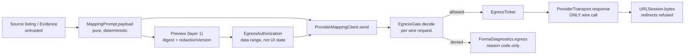

# Forma 隐私与外发契约（PRIVACY-EGRESS-CONTRACT）

> 状态：P3-A 切片 2d。冻结 SPEC v0.1.1 §9、PLAN §8.3 的产品语义未改；本文是实现口径与证据。
> 本轮**不启用 P3-B**：没有真实 Provider 调用、没有凭据、没有真实业务文件、没有 DEVONthink 写入。

## 1. Trust Boundary

三层必须分开，任何一层都不得冒充另一层：

| 层 | 内容 | 身份 |
| --- | --- | --- |
| 1. Mapping semantic payload | `MappingPrompt.system` + `MappingPrompt.payload` 的字节 | `semanticDigest` = SHA-256(system ⧺ payload) |
| 2. Provider-specific body | 语义 payload + `model`、完整 JSON Schema、`max_output_tokens`、Provider 自己的 envelope | 由 `wireDigest` 覆盖 |
| 3. Wire metadata | URL、method、headers（`Authorization`/`x-api-key` 只记录"存在"，绝不记录值）、body 字节 | `wireDigest` = SHA-256(以上，凭据降为 `present`) |

`ProviderMappingClient.Preview` 只持有第 1 层。它的注释不再声称"实际发送的完整字节"：模型 ID、Schema、token 上限和 header 是 transport 之后才加入的。`semanticDigest` 与 `wireDigest` 在 gate 里被要求不相等，避免把语义摘要冒充完整 HTTP 请求摘要。

## 2. Existing Security Contract Audit（Slice 2d 开始前）

`Sources/FormaCore` 只有一个外发原语：`ProviderTransport.response` → `session.bytes(for:delegate:)`。两个 host 硬编码在 `makeRequest`；`ProviderTransport.StructuredRequest` 没有 base-URL 注入。发送方只有 `ProviderProbe.run`（合成探测句）与 `ProviderMappingClient.map`（真实文档）。

**确实存在的保护**（本轮保留，不重复推导）：ephemeral / 无 cookie / 无 URL cache / 无 credential storage 的 session（`ProviderTransport.makeSession`）；`allowCloud` 早于 Keychain 读取；`validModelID` / `validKey` 形状校验；`model.contains(key)` 拒绝；状态映射丢弃 Provider 错误正文；`Content-Length` 与逐字节双重响应上限；Provider 自报 model 含 key 时拒绝；Schema 先校验后 decode；`RejectProviderRedirects` 拒绝重定向；`FormaDiagnostics.failure` 只记 operation + error code。

**审计确认的缺口**（已在代码里修复或明确披露）：

1. 授权只有一个 `Bool`，没有 provider / model / endpoint / 数据类别 / 脱敏版本 / 撤销 / 失效条件。
2. `Preview` 与实际发送共用构建路径，但没有任何东西把授权绑到范围或摘要；UI 明确写着"预览不是收据"。
3. `repairPayload()` 与 429 重试不再经过任何授权检查；`MappingAttempt.payloadDigest` 只报告首问，repair 没有独立身份。
4. `MappingPrompt.payload` 对 `evidence[].locator` 的 sheet/part 名、CasePack 文本、System Prompt 动态字段未应用脱敏计划。
5. `constraints.redaction_version` 恒为 `redaction.v1`，即使 `.none` 没有替换任何已知词。
6. 可分享的 `redacted/manifest.json` 只改 `entries`：`validation_report` 的 `instancePath`/`detail` 与 `FieldOutcome.conflicts`（模型自由文本）未脱敏。
7. 重定向拒绝此前无测试；`x-api-key` 是自定义 header，第二跳会带凭据。
8. `RedactionPlan.leaks()` 只回答"调用方自己的词表是否存活"，无法认证 payload 干净。
9. `MappingAttempt.violations[].detail` 由 `safeDetail` 去引号，但并非对任意不可信正文的保证。

## 3. Egress Scope

`EgressContract.version = "egress.v1"`、`scopeVersion = "scope.v1"`。`EgressScope` 记录：provider、model、endpoint（`.provider` 或显式 `.local(URL)`）、mode（`.cloud`/`.local`）、允许的数据类别集合、redaction policy version、`identitySubstitution`、跨作用域占位符关联策略（`workspace-only`）、scope digest。

`EgressAuthorization` 是**值**：在同意时由 preview 与设置快照构造一次，记录 `grantedAt`、`expiresAt`、`previewDigest`、`binding`、`allowsReviewRequiredContent`、`revoked`。它不是 UI 绑定；`revoking()` 返回撤销副本。

`allowCloud` 仍然必需，但只是 gate 的第一个条件。`EgressGate.decide` 依次校验：cloud 开关 → 授权存在 → 契约/范围版本 → 撤销/过期 → provider/model/endpoint/mode → 数据类别 ⊆ 授权类别 → redaction 版本 → identity 计划未变 → exact-binding 的摘要一致 → 敏感内容评估 → 凭据存在 → 语义/线摘要齐全且不相等。任一不满足返回稳定的 `EgressDenialReason`，不产生 ticket。

`.local` 不是"用户输入了地址就安全"：它仍需独立 grant、精确 endpoint 和显式类别，且 `ProviderTransport.response` 在 `session.bytes` 前再次比对 URL。硬编码 cloud host 现由 `EgressEndpoint.canonicalURL` 单点定义，改 host 会变成 `.endpointMismatch`。

**单一阻断点**：`ProviderTransport.response(_:limit:ticket:)` 现在要求 `EgressTicket`。没有 ticket 无法触达 `session.bytes`，因此调用方不能绕过 gate 自建 `URLRequest`。

## 4. Redaction Coverage Matrix

| Field | Source | Trust | Transformation | Egress permission | Test |
| --- | --- | --- | --- | --- | --- |
| `entries[].path` | 源文件相对路径 | untrusted | `redact(path:)` | `.filePaths` | `payloadLeaksNothing`, `redactedShareHasNoCanaries` |
| `evidence[].excerpt` | 文档正文 / 表格 | untrusted | `redact(text:)`（600 上限） | `.evidenceExcerpts` | `redactionPreservesRoles`, `unknownSensitiveContentSendsNothing` |
| `evidence[].path` | 证据行相对路径 | untrusted | `redact(path:)` | `.filePaths` | `payloadLeaksNothing` |
| `evidence[].locator` sheet/part | 工作簿 / 包内名称 | untrusted | `redact(text:)`；page/cell/paragraph/range 数值保持 | `.evidenceExcerpts` | `sensitiveLocatorText` |
| `context.candidates[].project_key` / `display_name` | 目录/上下文推断 | derived | `redact(path:)` | `.projectContext` | `contextIsScopedToBatch` |
| `field_rules[].rule`、`categories[].meaning` | 已审核 Profile | trusted | identity 计划逐字；配置计划时 `trusted()` 替换已知词 | `.profileRules` | `systemPromptContent`, `casePackContentIsCovered` |
| System Prompt 动态字段（displayName / versionKey / counterExamples / casePack version） | 已审核配置 | trusted | 同上 `trusted()`；注入文本永远不进入 system | `.systemPrompt` | `injectionIsQuotedDataOnly` |
| `cases[].*` (scenario / summary / citations / why_not / expected) | 已审核、预脱敏 CasePack | trusted | identity 逐字；配置计划时 `trusted()` / `redact(path:)` | `.casePackExamples` | `casePackContentIsCovered` |
| `repair_instructions` | 程序生成的 rule + JSON pointer | trusted | `Violation.logSummary`，绝不携带模型答案或原文 | `.repairInstructions` | `repairRoundIdentity` |
| `entries[].extension/size_bytes/hydration_pending/storage` | 文件元数据 | low | 原样（无自由文本） | `.filePaths` | `nativeStructuredRequestAndUsage` |
| Provider 返回错误正文 | Provider | untrusted | 状态映射丢弃，不进日志/报告 | 不外发 | `reportsHTTPStatusWithoutResponseBody` |
| `MappingAttempt.violations[].detail` | 模型输出 | untrusted | `safeDetail` 去引号 + 200 上限；repair 只用 `logSummary` | 不进日志 | `forgedOutputIsRejected` |
| 日志 / Diagnostics | 程序状态 | trusted | 仅 operation、error code、ticket 的 digest/version 摘要 | 允许公开 | `logSafeDiagnostics` |
| 可分享 manifest | 工作 Manifest | mixed | `relativePath`、`target`、`associations`、`metadata`、`fields[].value/conflicts`、`providerReasoning`、`report.violations` 全部经计划 | 显式 `redaction:` 才生成 | `redactedShareHasNoCanaries` |
| `EvaluationArtifact` / Benchmark Result | 运行事实 | trusted | 不含 Manifest、路径、证据正文、凭据 | 允许公开 | `redactedExportAndSchema`, `artifactVersionCompatibility` |

角色保留沿用 `RedactionPlan.Role`：customer / vendor / bidder / agent / person / project / amount / identifier。占位符由 `(salt, role, term)` 派生，同一作用域稳定；`crossScopeLinking = "workspace-only"` 明示跨请求关联范围，salt 与 term→placeholder 表不进入任何公开工件。金额保留"有值/无值"结构：`«金额…»` 由数值摘要派生，日期、招标编号、版本、产品型号不被误判为报价（`identifiersSurviveAmountMatching`）。

## 5. Unknown Sensitive Data

已知词替换与未知内容检测是两件事。`SensitiveContentScanner` 是一个**刻意狭窄**的检测器，输出四态：

- `.blocked`：调用方声明的已知词仍存活。
- `.reviewRequired`：出现它无法归类的高风险形状（邮箱、凭据样式 token、手机号、URL userinfo、身份证形状）。
- `.allowed`：无已知词存活、未发现上述形状，**不等于 100% 匿名化**。
- `.redacted`：配置了非 identity 计划且上述检查通过。

`.reviewRequired` 默认被 gate 拒绝（`unknownSensitiveContent`）；只有在 grant 里显式设置 `allowsReviewRequiredContent: true` 才放行。`RedactionPlan.none` 的 `isIdentity` 事实随 ticket 的 `identitySubstitution` 与 `redactionVersion = "identity"` 一起公开，`payload` 的 `constraints.redaction_version` 不再谎称 `redaction.v1`。不设置任何"100% 敏感信息检测率"断言。

## 6. Threat Matrix

| 威胁 | 入口 | 防御 | 证据 |
| --- | --- | --- | --- |
| 默认外发 / 仅凭 `allowCloud` | 任何调用方 | gate 多条件 + 客户端无 grant 即拒绝 | `cloudDeniedByDefault`, `authorizationMissing`, `cloudDeniedSendsNothing` |
| 无凭据仍发请求 | Keychain 缺失 | 粗粒度 key 检查 + gate `credentialMissing` | `noCredentialNoRequest` |
| Scope 漂移（provider/model/endpoint/mode/版本/类别） | 调用参数 | gate 逐项比对 + transport 二次比对 URL | `scopeIdentityMismatches`, `scopeMismatchSendsNothing` |
| 授权撤销 / 过期后补发 | 重试路径 | 每次 wire 请求前重新 decide；`revoking()` | `revocationAndExpiry`, `revocationSendsNothing`, `retryKeepsScope` |
| 重定向带 `x-api-key` 第二跳 | HTTP 3xx | `RejectProviderRedirects` 返回 nil + gate/transport endpoint 比对 | `redirectRefusal`, `redirectCannotEscapeScope` |
| Preview 之后字节/范围变化 | 证据重读 | `.dataRange` 绑定 + 每次重新计算 semantic/wire digest；精确摘要可用 `.exactPayload` | `previewMismatch`, `previewMismatchSendsNothing` |
| 语义摘要冒充完整请求摘要 | 报告层 | `wireDigest` 独立计算且必须不等 | `digestLayersStaySeparate`, `allowedSendIsObservable` |
| Repair 注入模型原文 / 扩大范围 | Schema 违规 | `repairPayload` 基于原始 preview，仅加 `logSummary`；每轮独立 ticket | `repairRoundIdentity` |
| 已知敏感词、未知高风险形状 | 文档内容 | `RedactionPlan` + 四态评估 + 默认拒绝 reviewRequired | `scannerClassifiesSyntheticCanaries`, `unknownSensitiveContentSendsNothing` |
| 日志/导出泄漏 | os_log、share copy | 仅 code/digest；redacted copy 覆盖 report/conflicts/fields | `logSafeDiagnostics`, `redactedShareHasNoCanaries` |
| Prompt Injection 越权 | 文件名/正文/表格/历史元数据 | 见 §7 | `injectionIsQuotedDataOnly` 等 |
| 身份计划冒充脱敏 | `.none` | `identity` 版本与 `identitySubstitution` 披露 | `identityPlanIsMarked`, `redactionPolicyChanges` |
| 凭据值进入导出摘要 | header | `EgressWireIdentity` 把凭据降为 `present` | `wireDigestIgnoresKey` |

## 7. Preview / Send Binding

预览与发送共用 `ProviderMappingClient.preview` → `MappingPrompt.system/payload` 一条构建路径；`map` 自己重建 preview 并发送其 `payload`。`Preview` 现在还带 `redactionVersion`，UI 直接读它而不是重算当前设置。

授权针对**数据范围**（类别集合、provider、model、endpoint、redaction 版本、identity 状态），不针对随时变化的 UI 状态。产品契约明说"预览不是收据"：`runMapping` 在发送前重读文件正文，excerpt 可以不同，所以默认 `.dataRange`；`.exactPayload` 供能证明字节不变的调用方与严格模式测试使用。`previewDigest` 只用于审计和 `.exactPayload` 比对。

已授权范围内的正常批处理无需逐批人工批准：同一 grant 覆盖一个 run 的多个 batch；gate 按每个 wire 请求重新判定，重复判定不等于重复审批。数据类别、脱敏计划或授权范围失效时，当前发送被拒绝而不是静默沿用旧授权。

## 8. Repair / Retry Semantics

`map` 的 repair 轮基于**原始 preview payload** 重建，仅追加 `repair_instructions`（`Violation.logSummary` = 规则名 + JSON pointer，20 条上限），绝不把模型的错误答案或敏感原文塞回去。每轮有自己的 `semanticDigest` 与 `wireDigest`，`MappingAttempt.requestIdentities` 按 wire 请求顺序记录 ticket（`kind` = `firstAsk` / `repair` / `rateLimitRetry`），`payloadDigest` 仍然只命名首问。429 重试与 repair 是两个独立预算；重试前重新检查取消与 gate，取消/超时不产生未经授权的补发。2b 的 `requests` / `rateLimitRetries` / `usage` 记账与 `runID` / `manifestID` 派生材料未改。

## 9. Prompt Injection Boundary

十组合成夹具：忽略 System Prompt、改输出 Schema、伪造 system/developer 消息、要求调用 DEVONthink 写工具、伪造 `entry_ref`、覆盖 `source_id`/`evidence_id`、要求读 Keychain、恶意 URL 与外发指令、Markdown/XML/JSON 角色逃逸、Unicode/控制字符/混合语言。

**确定性安全性质（Stub 已证明）**：不可信正文只作为 JSON string value 进入 `entries`/`evidence`/`cases`，不会成为 payload 的结构键；System Prompt 的信任边界与六条 Profile 反例逐字不变；结构化输出 Schema 拒绝多余字段、身份字段与伪造引用；跨批 evidence 在构建期被拒绝；非法 ref 不进入 manifest；`MappingPrompt` 不含任何写工具名或执行标志；Validator 在注入导致的错误响应下保持安全状态（`unknown`/hold），模型无法赋予自己系统身份或执行权限。**这些是 Forma 自己的结构性质，不是模型行为结论。**

**模型行为性质（未验证）**：模型是否遵从恶意指令，在无 P3-B 授权、无真实模型调用时不能宣称已验证。该结论保持 BLOCKED。

## 10. Test Evidence

- `EgressContractTests`（19 用例）：gate 的授权/范围/撤销/摘要/本地模式/四态评估/日志与线摘要安全，以及重定向 delegate。
- `PrivacyEgressTests`（18 用例）：HTTP Stub 可观察请求的允许/拒绝、repair 身份、429 重试、取消记账；注入夹具的 10 类结构性质；redacted share copy 的 canary；1.0 artifact 兼容。
- 既有回归：`ProviderTests`（含改用有效 grant 的 429/失败记账）、`MappingPromptTests`、`ManifestExportTests`、`EvaluationRunnerTests`（artifact 1.1）、`EvaluationBenchmarkTests`。

所有测试使用 `ProbeURLProtocol` / `MemoryKeyStore` / `SubstituteAnswerer`；无真实网络、无真实凭据。

## 11. Known Limitations

- `SensitiveContentScanner` 不是匿名化证明：未登记的名字、地址、内部编号可能通过 `.allowed`。默认拒绝 `.reviewRequired` 只覆盖可命名的形状。
- `.none` 计划只替换金额/长十六进制标识符，不替换任何已知词；ticket 明确披露 identity，但真实外发不应依赖硬编码公共 salt 获得匿名性。
- 未做 TLS pinning，仅依赖系统信任链；未做文件扩展名/大小的发送前白名单。
- Anthropic 请求体没有与 OpenAI `store:false` 等价的保留控制（既有差异，本轮未改变产品语义）。
- 主导出 bundle（`manifest.json`、`validation-report.json`、`exceptions.json`）是本地工作记录，**不是**可分享副本；只有显式 `redaction:` 生成的 `redacted/manifest.json` 可分享。
- 本地模式目前只有契约与测试；`ProviderTransport.makeRequest` 仍硬编码两个 cloud host，没有端到端 local server 接线。
- `ProviderProbe` 使用内置的 `.syntheticProbe` 受限 grant（无文档类别），不是用户预览授权；它仍走同一个 gate。

## 12. Deferred macOS Checks

真实 Provider 凭据/Keychain ACL、真实外发授权 UX、Provider 数据处理政策展示、os_log 在真实系统日志中的隐私标记、本地 API 服务模式端到端、真实文件名的脱敏判别力前后对照（P2-ACCEPTANCE 中已列为 BLOCKED）。见 `docs/MACOS-VALIDATION-BACKLOG.md` M2 / M10。P3-B 的四项外部前置条件仍缺。

## 13. Contract Delta

本轮**未改**冻结 SPEC 的产品语义：仍要求首次云端使用经用户明确启用并说明范围、离线扫描始终可用、占位符保留角色、日志默认脱敏、Mapper 无写工具句柄。实现上的变化是"授权从布尔升级为版本化范围"，属于 §9 强制控制的可验证落地，不是新产品政策。

需要 Owner 决策但不擅自实施的两点：

1. **默认拒绝 review-required 内容**：现在未显式授权时，含邮箱/凭据样式/手机号等高风险形状的 batch 会被拒绝，而不是"照发并声称已脱敏"。若产品希望默认放行，需要明确授权 UX 与文案，属产品语义变更。
2. **真实 Provider 的保留控制差异**（OpenAI `store:false` vs Anthropic 无等价字段）：需要在 P3-B 授权范围与 Provider 政策展示中确认，不在本轮静默添加或删除字段。
