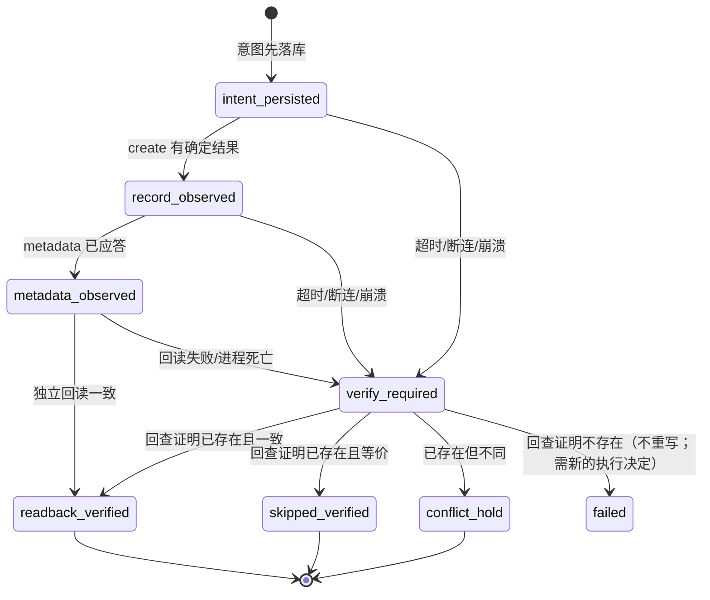

# R1 — Readiness Assessment & Implementation Plan

状态：**调查与实施方案已交付；R1 Batch 1 工程部分已实施**（见 §5.1）。本文不改变 MCP 写入授权，不改变发行渠道决策，不修改冻结 SPEC。

- 依据：Issue [#24](https://github.com/Skyline-Gazer/Forma/issues/24)、[#9](https://github.com/Skyline-Gazer/Forma/issues/9)、[#52](https://github.com/Skyline-Gazer/Forma/issues/52)、`docs/SPEC.md`、`docs/PLAN.md`、`docs/ROADMAP.md`
- 调查基线：`dev` @ `e1a1379`；Batch 1 实施基线：`dev` @ `a3a3cf7`
- 调查方法：只读源码审计（逐类型/函数引用），不运行任何真实 DEVONthink 调用，不新增写入

## 0. 结论摘要

1. **I1 的写入与恢复机制只存在于 FormaCore，尚未接入应用**：`ImportExecutor`、`ImportRecovery`、`GuardedImportWriteTransport` 在 `FormaApp` 中**没有任何调用者**（`grep` 结果为空）。R1 的第一个真实风险不是打包，而是“把已验收的组件接成一个有生命周期的应用”。
2. **MCP 连接没有监督层**：读客户端只有 `discover()` 一条重建路径；写适配器 `DEVONthinkMCPWriteTransport` 的连接是 `let`，断连后**无法恢复**，只能新建实例。这是 P0。
3. **退出/崩溃语义未接线**：应用没有 `NSApplicationDelegate`，窗口消失只调用 `cancelAll()`；`ImportRecovery.open` 无人调用，因此“下次启动先回查”目前只是库层能力。
4. **发行打包完全不存在**：仓库没有 `.xcodeproj`、`Info.plist`、entitlements、图标或签名配置；`swift build --package-path FormaApp` 只产出一个裸可执行文件。签名/公证/沙盒全部为未验证。
5. **B2 的现场驱动器未入库**：仓库里 `ImportReadTransport` 只有测试用 `FakeImportTransport`。已验收的行为无法从仓库复现，只能复用组件。
6. 因此 R1 不是“补几个弹窗 + 签名”，而是 **连接生命周期 + 发行工程** 两条独立工作流；本文把它们拆成可在 DevBox 完成、需要 macOS CI、需要真实 macOS、需要发行环境四类。

## 1. 现有工程能力审计

状态口径：**已实现** = 有类型、有路径、有测试；**部分实现** = 有类型但缺关键路径或未接线；**未实现** = 仓库内无代码；**缺少现场验证** = 代码存在但只有假替身证据。

| # | 能力 | 状态 | 关键证据 |
| --- | --- | --- | --- |
| 1 | DEVONthink MCP stdio Process 生命周期 | 部分实现 | `MCPStdio.swift`：`MCPChild` / `MCPStdio.start()` / `MCPChild.deinit` |
| 2 | MCP 初始化、断连、超时、重连 | 部分实现 | `MCPStdio.request`、`DEVONthinkReadOnlyClient.discover`、`DEVONthinkMCPWriteTransport.ensureReady` |
| 3 | ReadOnlyClient / WriteTransport 职责边界 | 已实现（类型级） | `ImportTransport.swift`、`DEVONthinkReadOnlyClient`、`DEVONthinkMCPWriteTransport`、`GuardedImportWriteTransport` |
| 4 | SQLite Ledger 持久化与恢复 | 已实现（库层），未接线 | `ImportLedger`、`ImportLedgerMigrations`、`ImportRecovery.open` |
| 5 | Bookmark / Security Scoped Resource | 部分实现 | `SourceWorkspace.register`、`StoredSourceRoot.withAccess` |
| 6 | Keychain | 部分实现 | `KeychainProviderKeyStore` |
| 7 | 应用退出时任务保存 | **未实现** | `FormaApplication` 无 delegate；`WorkspaceAreas.onDisappear` 只 `cancelAll()` |
| 8 | 下次启动状态恢复 | 部分实现 | `SourceStore.init` 的 `interrupted` 清扫、`WorkspaceModel.restore()` |
| 9 | 未决写操作恢复 | **未实现**（库层有） | `ImportRecovery.open` / `ImportExecutor.resume` 无调用者 |
| 10 | macOS 14+ API 兼容性 | 声明 + 编译验证，缺运行时验证 | 两个 `Package.swift` 均为 `.macOS(.v14)`；CI 为 macos-15 + Xcode 26.3 |

### 1.1 MCP Process 生命周期

- `MCPConfiguration.devonThink` 固定 `/Applications/DEVONthink.app/Contents/Library/LoginItems/DEVONthink MCP.app/Contents/MacOS/DEVONthink MCP --stdio`；`timeout` 默认 10 s，`maximumFrameBytes` 2 MiB。
- `MCPChild.init` 建 stdin/stdout 管道，对两端设 `O_NONBLOCK`，stdin 设 `F_SETNOSIGPIPE`，用 `DispatchSourceRead` 读 stdout；`stderr` 直接接 `FileHandle.nullDevice`。
- `MCPStdio.request` 惰性 `start()`：第一个请求才拉起子进程；并发上限 `pending.count < 8`。
- `MCPChild.deinit`：关 stdin、cancel source、`terminate()`，1 s 后仍在运行则 `SIGKILL`。
- **缺口**：无启动前可执行文件存在性/版本检查（只在 `process.run()` 抛错时映射为 `.unavailable`）；无重启策略；无退出码/信号记录；stderr 丢弃导致现场排障没有服务端输出；未处理子进程自己再派生的进程组。
- **双进程事实**：读客户端与写适配器各自持有一个 `MCPStdio`，同时工作时是**两个** DEVONthink MCP 子进程。B2 现场同时用了读写两侧（独立回读），说明至少能并存一次；长期并发与资源行为未验证。

### 1.2 初始化、断连、超时与重连

- 握手：`DEVONthinkReadOnlyClient.discover()` 发 `initialize`（首选 `2025-06-18`，接受 `2025-03-26`/`2024-11-05`），校验 `serverInfo`/`capabilities.tools`，再发 `notifications/initialized`，最后 `tools/list`。写侧 `ensureReady()` 做同样的握手，但**不**做 `tools/list`。
- 超时：每个请求一个 `deadline` Task → `fail(id, .timeout)`；**超时不会设置 `terminalError`**，连接继续可用（这正是“超时但写入已落库”必须靠回查的原因）。
- 断连：`close(with:)` 设置**粘性** `terminalError`，失败所有 pending，丢弃 child。此后同一实例的每个请求都抛该错误。
- 读侧重连：只有 `discover()` 有重建分支（`checkOpen()` 抛错 → 置 `connection = nil` → 新建）。其它方法走 `validatedConnection`，连接非 nil 但已 terminal 时直接抛错，**不会自动重建**；调用方必须先再 `discover()`。
- 写侧重连：`connection` 是 `let`、`ready` 是布尔，**没有任何重建路径**。一次断连后该实例永久不可用。
- **结论**：R1 需要一个显式的连接监督器，而不是依赖调用方记得重连。

### 1.3 读写职责边界

- `ImportWriteTransport`（lookup/create/writeMetadata）、`ImportGroupCreating`、`ImportWriteSurface`、`ImportReadTransport` 四个协议分开；`ImportTransport.swift` 注释说明“写入方读自己的回声不算证据”。
- `DEVONthinkMCPWriteTransport` 是仓库中**唯一**命名写工具的地方（3 个）；`GuardedImportWriteTransport` 在每次调用前 `permit`，`lookup` 还会把返回记录的库与父组登记为“已证明”，否则拒绝 metadata 写入。
- `DEVONthinkReadOnlyClient` 只有读工具枚举，写工具无法表达。
- **缺口**：`ImportReadTransport` **没有生产实现**（只有 `FakeImportTransport`）。B2 的独立回读因此来自未入库的装配代码。

### 1.4 Ledger 持久化与恢复

- `ImportLedger`（GRDB `DatabaseQueue`，与 `SourceStore` 同一个 `workspace.sqlite`）：`import_runs`、`import_operations`（`key_digest` UNIQUE）、`import_attempts`（`UNIQUE(operation_id, attempt)`）、`import_observations`、`import_leases`；迁移 `import-ledger-v1` 与 `import-ledger-v2`（新增可空 `authorization_digest`）。
- 相位机 `ImportPhase.canTransition(to:)` 在库层拒绝非法迁移，终态行不可再改；`recordIntent` 靠唯一索引拒绝第二次意图；`observeActualUUID` 只允许写一次。
- 恢复：`ImportRecovery.open` 调 `markInterrupted` 把 `intent_persisted`/`record_observed`/`metadata_observed` 扫成 `verify_required`，再返回 `inFlightOperations()`。
- **缺口**：无调用者；无 UI 呈现；无“先回查”的入口。DB 文件权限在 `SourceStore.init` 中设为 `0600`（含 `-wal`/`-shm`）。
- 单写者：`ImportSingleWriter` 用 `import_leases` 行做租约（默认 300 s），`reserve` 用内存集合做同进程互斥。**租约过期后另一进程可接管**，因此崩溃后不会永久锁死——但也意味着“以为自己是唯一写者”只在租约有效期内成立。

### 1.5 Bookmark 与 Security Scoped Resource

- 注册：`SourceWorkspace.register` 先 `startAccessingSecurityScopedResource()`，用 `.withSecurityScope` + `.securityScopeAllowOnlyReadAccess` 生成书签；若生成失败且当前进程**确实带** `com.apple.security.app-sandbox` entitlement（`SecTaskCreateFromSelf` + `SecTaskCopyValueForEntitlement`）则抛 `.unauthorized`，否则退回普通书签并把 `security_scoped` 记为 0。
- 使用：`StoredSourceRoot.withAccess` 解析书签（`bookmarkDataIsStale` → `.unauthorized`）、`startAccessing`、再比对 `rootIdentity` 与 `caseSensitive`，不匹配即拒绝。
- **权限撤销与“文件不存在”的区分**：扫描在 `root.withAccess` 失败时产出 `SourceScanIssue(.authorization)`；`SourceReconciliation.publish` 只有在 `issues.isEmpty && scope.relativePath.isEmpty` 时才把未见条目标记 `.missing`。因此**权限失败不会把文件误判为缺失**（代码级事实），代价是该次扫描只能是 `.incomplete`。
- **缺口**：书签失效没有恢复流程——没有 UI 解释、没有“重新授权”入口；用户只能重新添加目录（`register` 会更新同一 `resource_identity` 的书签）。外部卷卸载、iCloud 驱逐、目录被移动的行为未验证。

### 1.6 Keychain

- `KeychainProviderKeyStore`：`kSecClassGenericPassword`，`kSecAttrService = "com.skyline-gazer.forma.provider-api-key"`，`kSecAttrAccount = provider.rawValue`；`SecItemAdd` → `errSecDuplicateItem` → `SecItemUpdate`；读取 `SecItemCopyMatching`，`errSecItemNotFound` 返回 nil。
- **缺口**：未设 `kSecAttrAccessible`（走默认）；无删除/轮换；无访问组（沙盒下需 entitlement + 团队前缀）；锁定态错误映射为 `.storage`，用户看不到可操作的提示；无“凭据已存在但属于另一构建”的迁移策略。
- **命名不一致**：OSLog subsystem 是 `io.github.skyline-gazer.forma`，Keychain service 是 `com.skyline-gazer.forma.…`。bundle identifier 定案前改名会把已存密钥变孤儿，必须作为一次性迁移设计。

### 1.7 退出时保存

> 本节记录 Batch 1 之前的审计结论；T04 已实现退出接线，现状见本节末的「实现后」。

- （审计时）`@main struct FormaApplication: App` 只有 `Window` 与 `Settings` 两个 scene；无 `NSApplicationDelegateAdaptor`，无 `applicationShouldTerminate`，无 `applicationWillTerminate`。
- `WorkspaceAreas` 用 `.onDisappear { model.cancelAll() }` 取消 `work`/`fileWork`/`auxWork`。
- 已持久化的只有：扫描状态（`scans.state='scanning'` 下次打开被改成 `interrupted`）、`MappingStore.markInterruptedRuns`、UI 选择（`UserDefaults`）。
- **实现后（T04）**：`NSApplicationDelegateAdaptor(FormaAppDelegate.self)` 接管启动与退出；清理在 `applicationWillTerminate` 中**同步**执行——取消任务、关闭 discovery 的 MCP 连接——不做任何等待，因此不可能阻塞退出。`applicationShouldTerminate` / `terminateLater` 未使用。启动时调用 `ImportRecovery.open` 并呈现六态；Intent/Ledger 先落库，退出不承担写状态。

### 1.8 下次启动恢复

- `SourceStore.init` 迁移后立即：`UPDATE scans SET state='interrupted' WHERE state='scanning'`、`MappingStore.markInterruptedRuns`。
- `WorkspaceModel.restore()`：加载 `MappingProfile.shipped()`、`CasePack.shipped()`、`scopes()`，回退失效的 `selectedScopeID`，然后一次 `reload()`。
- **未实现**：Import 恢复（§1.9）、窗口/标签恢复、`selectedScopeID` 之外的会话状态（如上次扫描时间）不重建。

### 1.9 未决写恢复

- 库层齐备（§1.4），执行层齐备（`ImportExecutor.resume` 只允许只读结论：`intentMissing`、`authorizationChanged`、`sourceChanged`、`absent_after_unknown` 等），**应用层零调用**。
- 因此当前 GUI 不存在“未决写”这个概念：没有任何写入口，也就没有恢复入口。

### 1.10 macOS 14+ 兼容性

- 两个 `Package.swift` 都是 `platforms: [.macOS(.v14)]`，`swiftLanguageModes: [.v6]`；CI 固定 macos-15 + Xcode 26.3，`swift test` 与 `swift build --package-path FormaApp --product Forma`。
- 使用的 API（`URL.applicationSupportDirectory`、`ContentUnavailableView`、`NavigationSplitView`、`Table`、`Settings` scene、`defaultSize`）均在 macOS 13/14 范围内；仓库内**没有** `@available` 门控，也没有高于 14 的 API。
- **缺口**：编译目标 ≠ 运行时验证。没有 macOS 14 机器上的启动、SwiftUI 渲染与 MCP 子进程实测。

## 2. R1 技术设计

### 2.1 应用生命周期

**启动顺序**（设计，不是现状）

1. 打开 `workspace.sqlite`（`SourceStore.init`）：迁移 → 扫描/映射的 `interrupted` 清扫。失败则进入只读降级界面，不启动任何 MCP。
2. `ImportRecovery.open(ledger)`：把在途操作扫成 `verify_required`，得到 `inFlight` 清单。**不自动发起任何写，也不自动发起回查**。
3. 恢复 UI 选择（`UserDefaults`）：profile、scope、脱敏词表。
4. **不预热 MCP**：首次需要 DEVONthink 的动作（发现、只读探针、导入）才拉起子进程。理由：避免冷启动弹窗与隐式副作用，避免 DEVONthink 未安装时的启动失败。
5. 若 `inFlight` 非空：Workspace 顶部显示待核查横幅（条数、库、组、操作键摘要），提供“只读回查”按钮。

**MCP Process 管理**（新增 `MCPConnectionSupervisor` 设计要点）

- 所有权：读客户端与写适配器各自持有连接；supervisor 只管“能否用、何时重建”，不共享连接（独立回读的诚实性优先）。
- 健康检查：业务动作前 `ping`（2 s），失败视为不可用。
- 重建：`terminalError` 后允许**读侧**重建（指数退避，上限 3 次）；**写侧**重建只用于后续新请求，绝不重发已发出的请求；重建成功后必须先只读核查再决定。
- 资源：同一时刻最多 2 个子进程；导入结束后显式 `close()`；应用退出时 `terminate()` → 1 s → `SIGKILL`。
- 诊断：stderr 进有界环形缓冲（脱敏后仅本机可读），日志只写错误码与阶段，不写路径/UUID。

**正常退出**

- **实现选择（T04）**：清理放在 `applicationWillTerminate`，同步执行 `cancelAll()` 与关闭 discovery 的 MCP 连接，**不做任何等待**。原先设想的 `applicationShouldTerminate` + `.terminateLater` 没有采用：它需要异步回执，既容易把退出变成等待，也让"不阻塞"依赖实现细节；`applicationWillTerminate` 在类型上就不可能延迟退出。
- **不**在退出时改写相位：在途写的不确定性由下次启动的统一清扫处理（一处逻辑，避免两处漂移）。
- 不等待网络、不做“保存中”阻塞：每一步已经先落库，退出只需要停止新增动作。

**异常退出**（崩溃、断电、强杀）

- 依赖已落库的意图：`intent_persisted` 之后崩溃 → 下次启动变 `verify_required`。
- 依赖租约过期：崩溃进程不会再释放租约，接管者要等 `expires_at`（300 s）或由用户显式接管。

**下次启动恢复**（用户可见语义）

关键约束（与 `ImportLedger` 的 `ImportPhase.canTransition(to:)` 一致，由 `ImportLedgerTests.transitionShape` 与 `verifyRequiredReachability` 钉住）：

- **不存在 `verify_required → intent_persisted`**。恢复流程只做只读，不能把一次未决操作推回"即将写入"。
- 回查证明记录不存在时，操作进入 `failed(absent_after_unknown)`，**不重写**。
- 再次写入必须是**新的执行决定**：只有多个键分量变化（新的 Manifest revision、目标关联等）后形成**新的 operation key**，并重新过 preflight 与授权；仅更换 operation ID 不能绕过 `key_digest` 的唯一约束（`recordIntent` 用该唯一索引拒绝第二次意图）。

**未决 Import 操作恢复流程**

1. 启动清扫得到 `inFlight`。
2. 用户点“只读回查” → 拉起只读客户端（独立进程）→ 对每条：`lookup`（结论性 + 唯一 + 业务身份确认）→ 比对库/父组/SHA/metadata。
3. 结果映射到四态：一致 → `readback_verified`/`skipped_verified`；不一致 → `conflict_hold`；证据不足 → 保持 `verify_required`。
4. 写新数据必须重新走 preflight + 新的执行决定；恢复流程永不调用 `create`。

### 2.2 权限与安全

- **书签**：保留 `.withSecurityScope` + 只读范围；新增失效检测 → UI 明示“需要重新授权该目录”，并复用 `register` 的同一 `resource_identity` 更新路径（不新建 scope）。`security_scoped = 0`（未沙盒的普通书签）必须在界面标为“开发构建”，发行构建要求为 1。
- **撤销与恢复**：权限失败映射为 `.authorization`，**不**映射为 `.missing`（§1.5 已成立）；恢复后要求重新扫描，不自动把旧条目当 present。
- **Keychain**：定案 bundle identifier → 迁移 service 名（读旧 → 写新 → 删旧，失败保留旧）；显式 `kSecAttrAccessibleAfterFirstUnlockThisDeviceOnly`（首版无后台 Worker 也可用 `WhenUnlocked`，需 Owner 选择）；提供删除入口；锁定态提示与 `.credentialMissing` 区分。
- **最小权限**：不申请 `com.apple.security.automation.apple-events`（不用 AppleScript 通道）；不申请全磁盘访问；只保留用户选择的目录书签。
- **敏感日志**：`FormaDiagnostics` 目前只写 `operation` + `error.code`（`privacy: .public`），egress 只写摘要/拒绝码。R1 新增的 MCP 监督层必须沿用同一约束：**不记录路径、UUID、字段值、凭据**；stderr 缓冲只落本机文件且默认不导出。

### 2.3 DEVONthink 集成

- 只走官方 MCP stdio：`Process` + `initialize`/`tools/list`/`tools/call`；不引入 AppleScript、不直写 `.dtBase2`、不复制 DEVONthink 可执行文件。
- 服务不可用：可执行文件缺失 → `.unavailable`（文案区分“DEVONthink 未安装 / MCP 组件缺失”）；握手版本不匹配 → `.incompatible`（不降级猜测）。
- 超时与断连：保持“未知即 VERIFY_REQUIRED”，禁止盲重试；写侧断连后重建连接但**不重发**。
- 写入状态回查：只通过只读客户端 + `get_imported_record_path` 的宿主只读读取计算 SHA；`export_record` 不在自动路径上。
- 版本漂移：每次运行复核 3 个写工具的 `inputSchema` SHA-256（B1/B2 已建立基线），不一致即停止。

### 2.4 发行准备

渠道沿用 Owner 2026-11-12 决策（**未锁定**：A 独立 Developer ID / B Setapp / C 将来 MAS），本节只列技术差异，不改决策。

| 项 | A 独立发行 | B Setapp | C Mac App Store |
| --- | --- | --- | --- |
| 最低系统 | macOS 14+ | 同 A + Setapp 要求 | 同 A + 审核规则 |
| 沙盒 | 非必需 | 非必需 | **必需** |
| MCP 子进程 | 允许 `Process()` | 同 A | **未验证**：沙盒下启动第三方 App 内可执行文件是 #52 的未决风险 |
| 签名 | Developer ID + Hardened Runtime | 同 A | Apple Distribution |
| 公证 | `notarytool` + `stapler` | 同 A | 走 App Store 提交流程 |
| 更新 | 自建或 Sparkle（需许可证审查） | Setapp 分发 | 不允许外部 updater |
| 付费 | 自建授权（需合规设计） | Setapp 计费 | In-App Purchase |

R1 交付物（技术侧）：`.app` bundle 布局、`Info.plist`（bundle id、版本、`LSMinimumSystemVersion=14.0`、`NSHumanReadableCopyright`）、entitlements（Hardened Runtime；A/B 不开沙盒）、图标、`codesign --options runtime --timestamp`、`notarytool submit --wait`、`stapler staple`、`spctl --assess`。

## 3. 工作分配

| 类型 | 工作 |
| --- | --- |
| **DevBox 可完成** | 真实读适配器（`ImportReadTransport` 实现，只读）、现场运行入口（显式 opt-in，默认拒绝）、连接监督器与重连状态机、退出/恢复接线（纯状态）、`ImportRecovery` 调用点、书签失效状态机、Keychain 迁移逻辑、打包脚本骨架（`Info.plist`/entitlements/`codesign` 调用）、脱敏与日志白名单、故障注入测试、文档 |
| **macOS CI 可完成** | `FormaCore` 单测、`FormaApp` 构建、`.app` 组装 + ad-hoc 签名 + `plutil -lint` + `codesign -dv` 结构校验、14.0 部署目标编译 |
| **必须真实 macOS** | Security Scoped Bookmark 的真实授权/撤销/恢复、外部卷与 iCloud 行为、Keychain 锁定与重装、MCP 子进程启停与断连重连、退出保存与重启回查、写入中强杀的崩溃恢复、macOS 14 运行时 |
| **后续发行环境** | Developer ID 证书与公证凭据、干净机安装与 Gatekeeper 评估、Setapp/MAS 条件性评估、仓库转 private |

原则：能在 DevBox 完成的不上 Mac；只有“真实 Apple 框架 + 真实 DEVONthink + 真实进程生命周期”才进第四类。

## 4. 风险矩阵

| ID | 等级 | 风险 | 依据 | 处置 |
| --- | --- | --- | --- | --- |
| R-01 | **P0** | 写适配器断连后不可恢复（连接 `let`、无重建） | `DEVONthinkMCPWriteTransport` §1.2 | 连接监督器 + 只重建不重发；单测覆盖“终态错误后新请求可用” |
| R-02 | **P0** | 恢复语义未接线：`ImportRecovery.open` 无调用者 | `grep` 无引用 | 启动顺序第 2 步接线；无 UI 不得上线写入口 |
| R-03 | **P0** | 现场驱动器未入库 → B2 不可复现 | `ImportReadTransport` 仅 `FakeImportTransport` | 入库真实读适配器 + opt-in 运行入口 |
| R-04 | **P0** | 打包/签名/公证/entitlements 全缺；bundle id 未定案 | 无 `.xcodeproj`/`Info.plist`/entitlements | R1-T07 先行，bundle id 在 Keychain 迁移前定案 |
| R-05 | **P0** | MCP 子进程在 Hardened Runtime / 公证下的启动行为未验证 | §2.4 | 发行前最小探针：公证后的 `.app` 内 `Process()` 拉起 MCP |
| R-06 | P1 | 书签失效无恢复引导 | §1.5 | 状态机 + UI 入口；真实 macOS 验证 |
| R-07 | P1 | 双 MCP 子进程并发行为未验证（读写各一） | §1.1 | 现场验证 + 失败降级为单连接（牺牲独立回读需 Owner 决策） |
| R-08 | P1 | Keychain service 命名与 OSLog subsystem 不一致，改名 orphan 密钥 | §1.6 | 迁移设计先行；不静默改字符串 |
| R-09 | P1 | 租约 300 s 过期后另一进程可接管，可能造成并发写者 | §1.4 | 单实例保护（`NSRunningApplication`/`flock`）或缩短接管窗口 + 只读核查 |
| R-10 | P1 | macOS 14 运行时未验证 | §1.10 | 一台 14.x 机器做冒烟 |
| R-11 | P1 | stderr 丢弃，现场故障无服务端信息 | §1.1 | 有界环形缓冲 + 脱敏 |
| R-12 | P2 | 设置页文案称“没有写入路径”，与 FormaCore 现状不符 | `SettingsView.swift` 文案 | 接线前改写为“当前构建未启用写入” |
| R-13 | P2 | 无隐私清单、无图标、无 DMG 打包、无更新机制 | 发行工程 | 随 R1-T07 一并补齐（更新机制需许可审查） |
| R-14 | P2 | CI 未接入 ADS pin 检查 | `ci.yml` 注释 | 发行前治理项，不阻塞 R1 技术验证 |

## 5. 下一阶段任务表

执行环境：`DevBox` / `macOS CI` / `Real macOS` / `Release env`。授权列：`—` 表示本轮文档工作即可完成，`Owner` 表示需要独立授权。

| Task | 工作内容 | 依赖 | 环境 | 授权 | 验收标准 |
| --- | --- | --- | --- | --- | --- |
| R1-T01 | 真实只读适配器 `DEVONthinkImportReadAdapter: ImportReadTransport`（读属性/父组/`contentPath` + 宿主只读 SHA） | 无 | DevBox + macOS CI | Owner（R1 开发） | 类型上不命名任何写工具；假传输测试覆盖 `shaVerified=false` 路径；CI 绿 |
| R1-T02 | 现场运行入口（显式 opt-in、默认拒绝、复用 `ImportWriteAuthorization`） | T01 | DevBox | Owner（R1 开发） | 无授权时运行即拒绝且零调用；计划输出可 dry-run |
| R1-T03 | `MCPConnectionSupervisor`：ping、退避重建、写侧不重发、终态错误可恢复 | 无 | DevBox | Owner（R1 开发） | Fake 子进程注入断连/超时；读侧恢复、写侧返回 `verify_required` |
| R1-T04 | 退出/启动接线：`applicationWillTerminate`、`ImportRecovery.open`、待核查横幅、只读回查入口 | T03 | DevBox + macOS CI | Owner（R1 开发） | 单测覆盖“启动即扫、退出不写”；重启后 `verify_required` 计数正确 |
| R1-T05 | 书签失效恢复：可用性分类、身份校验的重授权、GUI 引导 | 无 | DevBox | Owner（R1 开发） | stale/撤权可区分；异目录拒绝且不改行；不误标 `.missing` |
| R1-T06 | Keychain 生命周期：设备专用可访问性、删除/轮换、锁定态、只读 legacy 探测、可回滚迁移接口（**不改 service 名、不自动迁移**） | 无 | DevBox | Owner（R1 开发） | 合成 service 往返；锁定 ≠ 缺失；迁移保留 legacy |
| R1-T07 | 发行打包：`Info.plist`、entitlements、图标、`.app` 组装、`codesign`/`notarytool` 脚本 | 无 | DevBox + macOS CI | Owner（R1 开发） | CI 产出可 `codesign -dv` 的 `.app`；`plutil -lint` 通过 |
| R1-T08 | 诊断与脱敏：stderr 环形缓冲、日志字段白名单、隐私清单草案 | T03 | DevBox | Owner（R1 开发） | canary 测试证明路径/UUID/凭据不进日志 |
| R1-M01 | 书签授权、撤销、恢复、外部卷、iCloud 现场验证 | T05 | Real macOS | Owner | 每步记录：撤销后扫描 `.incomplete` 且无 `.missing`；恢复后重扫一致 |
| R1-M02 | Keychain 锁定/重装/迁移现场验证 | T06 | Real macOS | Owner | 锁定态可读提示；重装后旧密钥迁移成功或明确失败 |
| R1-M03 | MCP 启停、断连重连、双进程并发、DEVONthink 升级后重跑 | T03 | Real macOS | Owner | 断连后读恢复；写不重发；版本 digest 漂移即停 |
| R1-M04 | 退出保存 + 重启回查（含在途写） | T04 | Real macOS | Owner | 正常退出无新增写；重启后只读回查并呈现四态 |
| R1-M05 | 写入中强杀（`kill -9`）崩溃恢复 | T04 | Real macOS | Owner（含写预算） | 重启后 `verify_required` + 只读结论，无重复记录 |
| R1-M06 | macOS 14.x 运行时冒烟 | T04 | Real macOS | Owner | 启动、扫描、只读发现可用；记录版本 |
| R1-R01 | Developer ID 签名 + 公证 + staple + 干净机安装 | T07 | Release env | Owner（证书/凭据） | `spctl --assess` 通过；干净机首启可用；MCP 可拉起 |
| R1-R02 | Setapp / MAS 条件性评估（仅当选择该渠道） | R01 | Release env | Owner（渠道决策） | 结论为 PASS/FAIL/BLOCKED，不预设可上架 |
| R1-R03 | 发布前仓库转 private + 访问复核 | R01 | Release env | Owner | 可见性、CI、依赖拉取、签名流水线全部复核 |

### 5.1 Batch 1 执行记录（2026-11-14）

Owner 授权 Batch 1：T01、T02、T03、T04、T07、T08。仅 DevBox + 合成测试 + GitHub macOS CI。

| Task | 状态 | 交付 |
| --- | --- | --- |
| R1-T01 | **DevBox Implemented · macOS CI Verified** | `DEVONthinkImportReadAdapter`（PR #79） |
| R1-T03 | **DevBox Implemented · macOS CI Verified** | `MCPConnectionSupervisor` + 写工具契约复核（PR #80） |
| R1-T02 | **DevBox Implemented · macOS CI Verified** | `ImportRuntime`（PR #83） |
| R1-T04 | **DevBox Implemented · macOS CI Verified** | 启动清扫、六态呈现、只读回查入口、非阻塞退出（PR #84） |
| R1-T07 | **DevBox Implemented · macOS CI Verified** | `.app` 组装 + ad-hoc 签名 + package job（PR #81；`docs/R1-APP-PACKAGING.md`） |
| R1-T08 | **DevBox Implemented · macOS CI Verified** | 诊断事件、stderr 有界缓冲、显式授权导出（PR #82） |

Batch 1 未触碰的边界：无真实 DEVONthink 写入、无写预算消耗、无 Developer ID / 公证、无发行、无 CNB 同步、`main` 与 ADS pin 未改、SPEC 未改。

仍未验证：一切**真实 macOS** 项（M01–M06）与**发行环境**项（R01–R03）；`docs/R1-BATCH1-HANDOFF.md` 是接续入口。

### 5.2 Batch 2A 工程记录（2026-11-14）

Owner 另行授权 Batch 2A 的**无真实写入工程**：T05、T06、T04 补齐（只读 Recovery 接线）与文档一致性。现场验证仍为 BLOCKED（执行主机不是 macOS，见 `docs/R1-BATCH2A-REPORT.md`）。

| Task | 状态 | 交付 |
| --- | --- | --- |
| R1-T05 | **DevBox Implemented · macOS CI Verified** | `SourceRootAvailability` / `SourceScopeStatus` / `reauthorize(scope:with:)` + 侧栏与横幅（PR #87） |
| R1-T06 | **DevBox Implemented · macOS CI Verified** | `KeychainCredentialStore`（device-only、删除/轮换、锁定态、legacy 只读探测、可回滚迁移接口）+ 11 例测试（PR #88） |
| R1-T04 补齐 | **DevBox Implemented · macOS CI Verified** | `ImportRecoveryScopeConfirmation` / `ImportRecoveryCoordinator` + 读范围确认表单与实际回查（PR #89） |

CI 上的一条真实限制（不是代码缺陷）：macOS 的文件型 login keychain **接受但不回读** `kSecAttrAccessible`，所以真实 Keychain 测试只能断言"未报告或正是所请求的值"；属性请求本身由内存后端测试钉住，真实回读列为 M02（需 data protection keychain 或真机）。

边界：未改 Keychain service 名、未自动迁移、未触碰真实凭据、未发起任何 DEVONthink 写、未开放 Import 写入。

仍未验证：M01–M06 的真实 macOS 行为（撤销授权、stale security-scoped bookmark、锁定 Keychain、真实 MCP 回查、GUI 交互）与 R01–R03。

## 6. 需要 Owner 决策的事项

1. ~~是否正式授权 R1 开发~~ → **Batch 1 已完成（§5.1）；Batch 2A 的工程部分已完成（§5.2）**。**真实 macOS 现场验证仍待执行；Batch 2B 未授权。**
2. ~~建议分两批~~ → Batch 1（T01–T04、T07、T08）与 Batch 2A 工程（T05、T06、T04 补齐）均已完成；剩余为真实 macOS 现场（M01–M06）与发行环境（R01–R03）。
3. **bundle identifier 与发行渠道**：bundle id 必须在 Keychain service 迁移（T06）之前定案；渠道沿用 2026-11-12 决策，不因 R1 调查而改变。
4. **Keychain 可访问性策略** → 已按候选值实现为 `kSecAttrAccessibleWhenUnlockedThisDeviceOnly`（新条目）；如需改为 `AfterFirstUnlockThisDeviceOnly`，需 Owner 决定并作为一次显式变更。
5. **R1-M05 的写预算**：崩溃注入会产生真实记录，必须单独批准，且与 I1 剩余探针（响应前断连、`dropped_fields`、返回结构）分开审批，不合并预算。

## 7. 本次调查的验证状态

| 结论类型 | 依据 | 状态 |
| --- | --- | --- |
| 代码存在性与接线情况 | 逐文件/逐符号阅读（§1 的引用） | **VERIFIED**（本机只读） |
| 缺失能力 | `grep` 无引用（`ImportRecovery`、`ImportExecutor`、`NSApplicationDelegate`、`.xcodeproj`） | **VERIFIED**（本机只读） |
| macOS 运行时行为 | 无真实 macOS 会话 | **NOT_VERIFIED**（Batch 1 未改变） |
| Batch 1 代码的编译与单测 | GitHub macOS CI（每个 PR） | **macOS CI Verified**（PR #79–#84） |
| Batch 1 的 GUI 行为（横幅、禁用状态、退出清理） | 仅编译通过，未人工操作 | **NOT_VERIFIED** |
| 签名/公证/MCP 在 Hardened Runtime 下启动 | 无证书、无发行环境 | **NOT_VERIFIED** |
| B2 现场结论 | 沿用 `docs/I1-B2-ACCEPTANCE.md`，本轮未重读原始证据 | 见该文 §0.2 |
