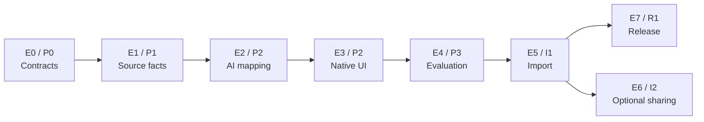

# Forma — Implementation Roadmap (Approved Planning Baseline)

**状态：P0/P1/P2 已授权并完成工程实现；P3-A（离线评测基础设施）已授权进行中；I1-A（离线 Import 基础）已授权并完成离线实现，I1-B 真实写入未授权；P3-B 真实模型评测、I1-B/I2/R1 未授权。**  
**基线：** [SPEC v0.1.1 FROZEN](SPEC.md) · [PLAN v0.1](PLAN.md) · [PLAN PR #1 merged](https://github.com/Skyline-Gazer/Forma/pull/1) · [P2 验收报告](P2-ACCEPTANCE.md)  
**Owner 决策记录：** 2026-11-11（P0/P1 授权）· 2026-11-12（P2 收尾接受 + P3 拆分授权，见下方「授权历史」）

## 已批准的三项 Owner 决策

1. **AI Mapping 质量目标：候选值，非正式验收 Gate。** 初始参考 PLAN 提议的 precision_auto ≥95%、coverage ≥70%、field_precision ≥98%、high_confidence_error_rate ≤2%；应先做真实独立测量，结合 Profile、分层样本量、风险和置信区间，再由 Owner 批准最终 Gate。禁止将建议值写成已经获批通过。
2. **目标与年份：** Vendor Library 使用**独立的 DEVONthink 数据库**（具体库 UUID 和目录结构留待 V6 现场绑定）；Project Archive **保持现有 Group 布局**；completionyear 必须来自**已核实的归档完成事实**，不能从投标截止年、封面日期或产品年份猜测；不明则 hold。
3. **发行与生命周期：** **macOS 14+ 为当前开发基线**，P0/V7 核实兼容性；默认 GUI 退出时保存任务及未决操作状态，**下次启动先回查后恢复**。首版不做独立后台 Worker；签名/沙盒/分发策略以实测为准。

## 主链与可选分支

P2 的 E2/E3 可部分并行，但用户可操作的 Prototype 应形成完整 Mapping + UI 流程。I2 **不阻塞** I1 和 R1；V1–V4 优先为 Prototype 提供实际能力证据，V5 仅阻塞 Replicant 选项。

## Epic / Feature 索引

| Epic | 阶段 | Feature Issues | 验收出口 |
|---|---|---|---|
| [#2 E0 契约与只读能力](https://github.com/Skyline-Gazer/Forma/issues/2) | P0 | [#10 MCP/字段](https://github.com/Skyline-Gazer/Forma/issues/10), [#11 Providers/Extractors](https://github.com/Skyline-Gazer/Forma/issues/11) | V1–V4、真实只读探针；生产零写 |
| [#3 E1 来源事实](https://github.com/Skyline-Gazer/Forma/issues/3) | P1 | [#12 source_id](https://github.com/Skyline-Gazer/Forma/issues/12), [#13 snapshot/evidence](https://github.com/Skyline-Gazer/Forma/issues/13) | 重扫、移动、替换、快照和只读证据 |
| [#4 E2 AI Mapping](https://github.com/Skyline-Gazer/Forma/issues/4) | P2 | [#14 Context/Profile](https://github.com/Skyline-Gazer/Forma/issues/14), [#15 Providers/CasePack](https://github.com/Skyline-Gazer/Forma/issues/15), [#16 Validator](https://github.com/Skyline-Gazer/Forma/issues/16) | 双 Profile 真实 Manifest、可验证 Evidence |
| [#5 E3 Native UI](https://github.com/Skyline-Gazer/Forma/issues/5) | P2 | [#17 Mapping UI](https://github.com/Skyline-Gazer/Forma/issues/17), [#18 Privacy/Correction](https://github.com/Skyline-Gazer/Forma/issues/18) | Workspace/Mapping/Exceptions/Settings、脱敏/纠错闭环 |
| [#6 E4 质量评测](https://github.com/Skyline-Gazer/Forma/issues/6) | P3 | [#19 gold/metrics](https://github.com/Skyline-Gazer/Forma/issues/19), [#20 performance/cost](https://github.com/Skyline-Gazer/Forma/issues/20) | 已授权 P3-A：金标准规范与离线评测基础设施（可用合成数据与确定性替身）。暂未授权 P3-B：真实模型与样本报告。正式 Gate 待 Owner 实测后批准（授权见下方「授权历史」） |
| [#7 E5 Import](https://github.com/Skyline-Gazer/Forma/issues/7) | I1 | [#21 Write/SHA](https://github.com/Skyline-Gazer/Forma/issues/21), [#22 Ledger/Recovery](https://github.com/Skyline-Gazer/Forma/issues/22) | 隔离记录读写回读、幂等、VERIFY_REQUIRED；离线准备评估见 `docs/I1-OFFLINE-PREPARATION.md`（未实施） |
| [#8 E6 Optional Sharing](https://github.com/Skyline-Gazer/Forma/issues/8) | I2 | [#23 Associations/Replicant](https://github.com/Skyline-Gazer/Forma/issues/23) | 元数据兼容才考虑 Replicant；不支持可关闭 |
| [#9 E7 Release](https://github.com/Skyline-Gazer/Forma/issues/9) | R1 | [#24 Release/Lifecycle](https://github.com/Skyline-Gazer/Forma/issues/24) | 真实安装、授权恢复、签名公证与重启核查 |

## 实施与治理边界

- **授权历史**
  - **2026-11-11（原文保留，不改动当时的时间记录）：** 实施 P0（技术契约与基础工程）与 P1（Scanner / Source Identity / Snapshot / Evidence / 最小 GUI），在 `dev` 以可独立审查的 PR 集成，并配置 GitHub Actions macOS 构建与单元测试。P2、P3、I1、I2、R1 未授权。
  - **2026-11-12（Owner 决策；取代上一条中「P2、P3 未授权」的现状效力，上一条作为历史证据保留）：**
    - P0 / P1：已授权并完成。
    - P2：已授权，工程实现完成；外部现场验收仍有未关闭项——Provider 真实调用、隔离 DEVONthink 库对齐、授权 OneDrive 目录三项保持 `BLOCKED`，GUI 人工交互保持 `NOT_VERIFIED`，且不得因阶段收尾而关闭；CI 编译成功与合成数据测试通过不得表述为真实环境验证通过，P2 不宣称生产就绪。
    - **P3-A：正式授权启动离线评测准备工作**（金标准数据集规范与评测基础设施，允许合成数据与确定性替身）。
    - **P3-B：真实模型评测暂未授权执行**，等待四项外部前置条件：Provider 真实 API 凭据与批准的模型、外发数据范围与费用预算；经确认的独立测试库 UUID 与只读范围；Owner 授权的真实扫描目录与访问边界；≥150 条经独立核实与脱敏的金标准样本。凭据一律经本地 Keychain 或经批准的 Secret 管理，不提交仓库。
    - I1 / I2 / R1：未授权。
    - 质量阈值（precision_auto ≥95%、coverage ≥70%、field_precision ≥98%、high_confidence_error_rate ≤2%）仍为待批候选值；正式 Gate 须在真实测量、分层、区间与风险分析后由 Owner 再次批准，Agent 不得自行宣布其已成为验收标准。
  - **2026-11-13（Owner 授权 I1-A：可靠 Import 的离线设计确认与基础实现）：** 允许在 DevBox + macOS CI 内开发 Preflight、SHA/快照校验、幂等操作键、版本化 SQLite Intent/Ledger、四态仲裁、单写者与重启恢复、Fake MCP Transport、故障注入与独立回读验证。幂等键为 `(source_id, snapshot_fingerprint, manifest_revision, target_association_id, operation_kind)`；写入前先持久化 Intent；不确定副作用进入 VERIFY_REQUIRED；不声明未经真实接口证明的 exactly-once。**明确禁止**：真实 DEVONthink 写工具调用、真实记录/Group 创建、生产库写入、真实文件 Import、真实 OneDrive hydration、真实 Provider 请求、修改冻结 SPEC、默认启用应用层 WriteClient、把 Fake Transport 成功当作现场验收。I1-B（隔离库真实写入、Metadata/UUID/SHA 回读、断连与重复运行）须 Owner 单独批准；在此之前 I1-A 只报 **Offline Verified**。
- 首阶段 Prototype 只读隔离 DEVONthink 库，禁止任何写入；生产 Project_Archive 现有 991 条记录不可修改。
- SPEC 产品契约有变化须先获 Owner 批准修订；一般实现细节以 PLAN 和对应 Issue 为准。
- 公开仓库只允许脱敏/合成案例；真实资料留本地。
- 不引入 Rust/Tauri、独立 RAG/Vector DB 或不必要服务。
- 正常执行异常驱动复核；不为每批资料引入不必要审批。
- 前一阶段授权（合并 PLAN、建立 Roadmap 与 Issues）已于 2026-11-11 执行完毕；进入 P0/P1 需要且已经取得 Owner 在本轮开发指令中的明确授权，后续阶段仍需另行授权。

## GitHub Project 看板状态

仓库 Issues 和本文件已经建立可执行的 Roadmap；**GitHub Projects v2 看板尚未创建**。当前连接只暴露 GitHub Issues 与 PR 的创建/管理能力，没有 GitHub Projects 的创建/添加条目写入接口，因此不能假装看板已经存在。将来有 GitHub Projects 写权限工具时，可按上表建立单个 Forma Project 并批量导入这些 Issues；不应重复创建任务。
